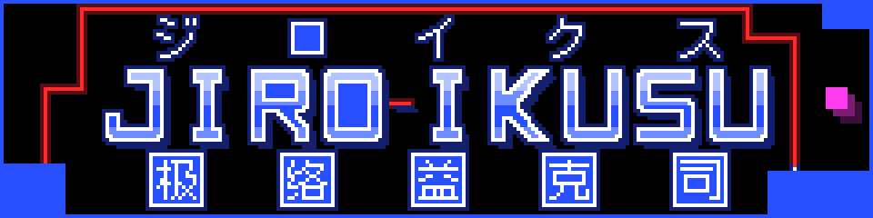
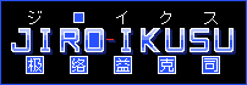
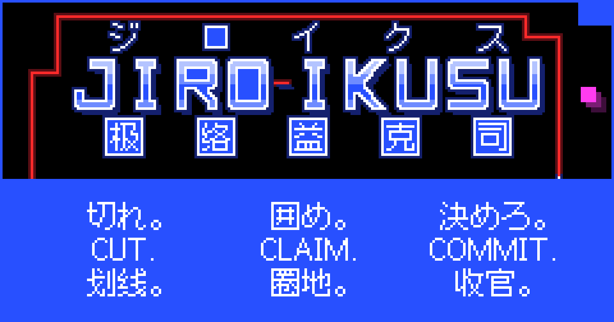

# Style guide

The visual identity of Jiro-ikusu (ジロイクス, 极络益克司): the name in three scripts, its colors, type, logo, banner and icons, and the rules for using them. Everything is drawn in the game's own cells and colors, so the logo, the banner and a level in play read as one thing.

This guide owns the rules. [`brand/src/`](../brand/src/) owns the numbers: every coordinate, glyph bitmap, palette hex value and checksum of the identity. The guide quotes hex values, contrast ratios and headline sizes, never a checksum or a glyph's coordinates; where a quoted value and `brand/src/` differ, `brand/src/` wins. `node brand/build.mjs` builds every asset from it ([§12](#12-assets-and-build)).

> **Status: adopted (2026-11-10).** `brand/` builds the assets, and the site wears the identity: the pages, `web/src/style.css` and the Jiro Pixel 12 font follow it. What the sections marked *planned* describe comes in follow-up pull requests ([§16](#16-adoption)); [§17](#17-open-questions) lists the open questions.



## 1. Name

| Script | Form | Notes |
|---|---|---|
| Latin | Jiro-ikusu | ASCII; the hyphen is U+002D |
| Logo capitals | JIRO-IKUSU | Drawn artwork only |
| Katakana | ジロイクス | U+30B8 U+30ED U+30A4 U+30AF U+30B9; `lang="ja"` |
| Hanzi, Simplified | 极络益克司 | U+6781 U+7EDC U+76CA U+514B U+53F8; `lang="zh-Hans"` |
| Pinyin | Jí-luò-yì-kè-sī | As in [`name.md`](../name.md); tone marks in NFC: í U+00ED, ò U+00F2, ì U+00EC, è U+00E8, ī U+012B |

| JI | RO | I | KU | SU |
|---|---|---|---|---|
| ジ | ロ | イ | ク | ス |
| 极 jí, pole | 络 luò, net | 益 yì, gain | 克 kè, overcome | 司 sī, take charge |

- **Latin:** Jiro-ikusu: capital J, hyphen-minus, lowercase i, no space, no macron. Pages, titles, metadata and alt text use the full name; Jiro alone is for code identifiers (*D13*: `jiro-core` and the rest) and engineering shorthand. JIRO-IKUSU exists only as the drawn logo or a CSS `text-transform`. Lowercase jiro-ikusu goes in URLs, the domain jiro-ikusu.win, file names, handles and storage keys (`jiro-ikusu.bindings`).
- **No macron, anywhere,** the logo included (owner, 2026-11-10): ジロイクス has a short ロ, while Jirō would spell ジロー, read as the given name 次郎, and give six kana where every lockup aligns five. ASCII also survives every URL, file name and font. Say it JEE-roh-ee-koo-soo.
- **Katakana:** full-width and solid, with no ・ and no ー; never half-width, never hiragana. **Hanzi:** Simplified forms only and solid, with no · and no space, never Traditional or mixed; in Japanese copy, 极络益克司 is the Chinese name, never kanji.
- **Pinyin** glosses the hanzi and never appears in a lockup: Jí-luò-yì-kè-sī, or jí · luò · yì · kè · sī in a table. The toneless Ji-luo-yi-ke-si goes only where tone marks cannot be typed, never in display text.
- **First mention:** Jiro-ikusu (ジロイクス, 极络益克司), then Jiro-ikusu. In HTML, kana go in `<span lang="ja">` and hanzi in `<span lang="zh-Hans">`.
- **Lockups:** kana above, the Latin base in the middle and always the largest, hanzi below, on shared columns. Neither CJK row alone is ever the logo. A two-line setting breaks after JIRO-, where the name breaks: ジロ | イクス, 极络 | 益克司. The hyphen exists only in Latin.

**Never write** Jirō, Jirō-ikusu, Jiro-Ikusu, Jiro Ikusu, JiroIkusu, Jiroikusu or Jiro-ix; ジロー, ジローイクス, ジロ・イクス, ｼﾞﾛｲｸｽ or じろいくす; 極絡益克司, 極络, 极络·益克司 or 极络益克斯; or pinyin without tone marks in display text. *D13* keeps Volfied and Qix out of product and contract names; this guide extends that to Taito, and to assets, alt text and metadata. Documents may cite them, as the README does.

## 2. Concept

**Double ruby (両側ルビ, ryōgawa-rubi).** Japanese typesetting can annotate a word on both sides: the reading on one, the meaning on the other. So JIRO-IKUSU is the base, always the largest row; the katakana ride above it as the sound; the hanzi stand below it as the meaning, since 极络益克司 was chosen for meaning as much as for sound (音意兼译). Kana and hanzi share one size, 11 cells, and five columns spaced by the group ruby of JIS X 4051 (1:2:1), each within 4 cells of its syllable.

**The capture rule is the type rule.** Every glyph is drawn on the field's 4-px cell, its edge a one-cell white line: white is the player, so this is the player's line. Whatever a line closes is claimed and painted claim blue, by the flood fill of [README §4.8](../README.md#48-capture) with the glyph's outside as the boss's region: the counters of R and O, and the square of ロ. Each hanzi stands on a ロ tile, a claimed square with a white rim, like a character on manuscript paper (原稿用紙); the same 口 sits inside 络, 克 and 司. The hyphen is a six-cell trail, the only red in the logo. The capitals are lit like a marquee: flat blue bands in their cores, and a deep-blue shelf under the word ([§4](#4-type)).

**Every hero image is an attract frame.** When nobody plays, a cabinet plays itself: every banner and card shows that demo stopped one move before a capture, the name inside the land the next move takes. A one-cell red trail leaves claimed land, wraps the name with stepped shoulders at different heights, and stops at the white player, one cell from land; the magenta boss waits outside, its two afterimages aimed at the cut; a one-cell halo, dark blue around white and dark red around red, lights it without blur.

**The name is one level.** 极 (pole) is the field, a black polar plain; 络 (net, thread; silk radical 纟) the rail, and the red thread spun off it; 益 (gain) the claimed land; 克 (overcome) the boss, never destroyed but overcome by taking the field around it; 司 (take charge) Commit (X), and the referee that settles paid runs.

**The game's colors are the palette:** black is open, blue is held, red is live; white is you, magenta is the boss, green is the minion ([§3](#3-color)).

### Why this direction

Five directions were drawn up: Claimed Chrome (chrome cell letters over an attract frame), Polar Field (极; the name under an aurora), Live Wire (络; the name as copper traces), Grid-Native (the board in play, from text cell maps) and Double Ruby. Double Ruby leads: its structure belongs to this name alone, its glyphs follow the game's capture rule, and nothing in it traces back to Volfied. It takes Claimed Chrome's attract frame, monogram and cabinet buttons, Grid-Native's sources, build and plate, Polar Field's latticed boss and stacked lockup, and Live Wire's trust line. Flat capitals lost the marquee energy the owner asked for, so they are lit: chrome survives only as flat bands of the game's blue inside the white line, with no gradient, bevel or outline.

## 3. Color

[README §4.1](../README.md#41-grid) freezes the field's colors as rule text: open field black (R4.1-3), claimed land blue (R4.1-4), trail red (R4.1-5). [`brand/src/palette.txt`](../brand/src/palette.txt) owns every hex value, and the build fails when `CELL_COLORS` or `ENTITY_COLORS` in render.ts, or a `:root` variable of style.css, disagrees with it, or when `SPAWN_AREA_COLOR` in `web/src/pages/editor.ts` is not the boss hex plus two alpha digits ([§12](#12-assets-and-build)). Contrast is WCAG 2.2.

**Game colors,** in `CELL_COLORS` and `ENTITY_COLORS` of render.ts:

| Token | Hex | Meaning and use | Contrast |
|---|---|---|---|
| field | `#000000` | `EMPTY`, open field: the ground of hero art, the canvas, the field plate | White on it 21:1 |
| claim | `#2850FF` | `CLAIMED` land, border and rail. Art: frame, land, a band of the capitals, counters, tiles. UI: the primary action, `--accent` | White on it 5.70:1; 3.41:1 on `--bg`, so never text |
| trail | `#FF2A2A` | `TRAIL`, the live cut: the cut and the hyphen, nothing else. Never in the UI | 5.62:1 on field, 1.53:1 on claim |
| player | `#FFFFFF` | The player: every glyph's line, tile rims, text in art; focus and the current page in the UI | 5.70:1 on claim |
| boss | `#FF3CF0` | The boss, and its spawn area at 33 % in the level editor's field (the game's field view, not the UI). Never in the UI | 7.16:1 on field |
| minion | `#3CFF78` | The minions, in the game only | 4.28:1 on claim |
| invulnerable-player | `#9A9A9A` | The player while invulnerable, in the game only | 2.03:1 on claim ([§9](#9-game-canvas-presentation-planned)) |

**Art tones,** for brand art; claim-deep alone also serves the UI:

| Token | Hex | Use | Contrast |
|---|---|---|---|
| chrome-hi | `#B4C4FF` | The capitals' top band. Art only | 12.28:1 on field |
| chrome-mid | `#6E8BFF` | The capitals' second band and foot. Art only | 6.80:1 on field |
| claim-deep | `#14206E` | The wordmark's shelf, the halo next to white; the UI's button shelf | 1.46:1 on field: decorative |
| trail-deep | `#5A0E14` | The halo next to red. Art only | 1.51:1: decorative |
| boss-ghost-1 | `#7A1D73` | The boss's first afterimage: 48 % of the boss over black, as a flat color. Art only | Decorative |
| boss-ghost-2 | `#3D0E3A` | The second afterimage: 24 %. Art only | Decorative |

**Page tokens,** in the `:root` of style.css, for the UI only:

| Token | Hex | Use | Contrast |
|---|---|---|---|
| `--bg` | `#0B0D12` | Page background | |
| `--panel` | `#151925` | Panels: HUD, setup, controls, wallet | |
| `--text` | `#E6E8EE` | Body text, HUD values | 15.86:1 on `--bg`, 14.31:1 on `--panel`, 17.14:1 on field |
| `--muted` | `#9AA1B2` | Labels, nav, secondary text, input borders | 7.51:1, 6.78:1 and 8.11:1 on the same |
| `--danger` | `#FF5A5A` | Error text, and the Out of lives title's drop | 6.35:1 on `--bg`, 5.73:1 on `--panel`; white on it 3.06:1, so never a fill under text |
| `--accent` | claim | The primary button, as `var(--claim)` | White on it 5.70:1 |
| `--link` | `#8FA6FF` | Links, always underlined | 8.39:1 on `--bg`, 7.57:1 on `--panel` |
| `--line` | `#2A3142` | Hairlines, the disabled button's fill | 1.50:1 on `--bg`, so never a control's only edge; muted text on it 5.02:1 |
| `--accent-hover` | `#1F3FD6` | The primary button on hover | White on it 7.66:1 |
| `--focus` | player | The focus ring, the current page | 19.43:1 on `--bg` |

- **Meaning first:** each color keeps its game meaning everywhere, blue also marking the primary action, and a game color keeps the hue README §4.1 names.
- **Cold land, hot thread:** large areas only black or blue; red, magenta and green stay small. Claim blue and trail red are never text.
- **The UI** uses the page tokens, plus field, claim, player and claim-deep only. Red never marks navigation or selection; errors use `--danger`.
- **Grounds:** full color only on field, `--bg` or `--panel`; mono white on claim blue, where the hyphen would be 1.53:1, and on photos; the plate or mono black on light grounds ([§5](#5-logo)). There is no light full-color version: black lines among the game's colors would read as open field.
- **Changes:** a color change in render.ts or style.css updates palette.txt and reruns the build in the same pull request ([`CLAUDE.md`](../CLAUDE.md)).

## 4. Type

### Jiro Caps: the logo's capitals

Seven drawn cell capitals, not a font, in `brand/src/glyphs-latin.txt`: J, I, R, O, K, U and S, each 16 × 20 cells, with 4-cell stems and bars and square corners, the bowls' outer corners notched by one cell. Upright, never italic. K's staircase arms keep it from reading as H, and S's notches from reading as 5. The hyphen is a 6 × 1 trail. Jiro Caps sets only the name.

**Lit capitals,** in full color:

1. **Line:** every ink cell with a non-ink cell among its 8 neighbors is white.
2. **Counters:** the empty cells that a 4-connected fill from outside the glyph does not reach are claim (README §4.8, the outside as the boss's region). This fills R and O.
3. **Core:** every other ink cell takes the color of its row in the letter. From the top: a band of chrome-hi, a band of chrome-mid, a band of claim, and a foot of chrome-mid. `brand/src/lockups.txt` gives the rows.
4. **Shelf:** every full-color wordmark, letters and hyphen, stands on a 2-cell shelf. For k = 1, then 2, every still-empty cell at (x + k, y + k) of a wordmark cell becomes claim-deep. The shelf belongs to the wordmark, so it appears in every full-color lockup and scene; it grows the box by 2 cells to the right and down where it reaches, and leaves at least one empty cell before any tile or kana.

Each band is one flat color, and the white line stays outermost: whatever the band, a letter's edge is white against black or claim-deep (the shelf, and the halo of hero art), 14.37:1 or more. Mono variants keep only the line, the hyphen, and the hanzi tiles' rims and glyphs, in one color.

### Fusion Pixel 12px: the logo's kana and hanzi

- **The font:** Fusion Pixel 12px Proportional SC 2024.05.12 by TakWolf, from `@fontsource/fusion-pixel-12px-proportional-sc@5.3.0` on npm; SIL OFL 1.1, with the Reserved Font Name "Fusion Pixel".
- **Why:** one 12-px design covers katakana, Simplified hanzi and Latin, on the cell of Jiro Caps. Its kana, Latin and Japanese tagline glyphs match its Japanese build; the hanzi that differ, 益 among them, take the Simplified forms the name needs.
- **In art:** glyphs are traced once into `brand/src/glyphs-cjk.txt` and `glyphs-pixel.txt`, one font pixel per cell: 11 × 11 cells for kana and hanzi, 9 cap rows for Latin (recipe in `brand/README.md`). All pixel text in art comes from them. The font is never served, and the name's CJK never set in a web font.
- **Kana** are white lines, with ロ's counter claim; **hanzi** stand in white on 15 × 15 ロ tiles, a white ring around a claim interior.

### system-ui: body text

`--font-ui` (system-ui first, [§8](#8-interface)): no download, the best hinting for long text, native CJK for `lang`-tagged spans. The pixel faces carry the voice, system-ui the reading; code, hashes and journals use ui-monospace, `--font-code` (the pages' `<code>` and the journal textarea), and addresses will *(planned)*: the footer's contract links, the wallet status and the Season leaderboard still show them in system-ui.

### Jiro Pixel 12: the UI's pixel face

- **What:** a subset of Fusion Pixel 12px Proportional SC, 106 code points (U+0020–007E, · × – — …, ← ↑ → ↓, ■ □), about 2.5 KB as `web/public/fonts/jiro-pixel-12.woff2`. Renamed, as the OFL requires of a Modified Version of a font with a Reserved Font Name, it keeps its copyright and license records. It ships with the package's full license text, `LICENSE-fusion-pixel.txt` beside it, which also carries the notices of the fonts Fusion Pixel draws on: Ark Pixel, Galmuri, Cubic 11, JF Dot M+H 12 and M+ BITMAP FONTS.
- **Why:** no anti-aliased pixel at 12, 24, 36 or 48 px in Chromium in the design test; tabular digits; a slashed zero; distinct I, l and 1; the design of the logo's CJK. DotGothic16 was dropped for outlines off its pixel grid.
- **Use:** HUD values, headings, end-of-level titles, and the touch controls' names and letters (CUT, SHIELD and COMMIT over A, B and X, at 12 px), only at 12, 24, 36 or 48 px, line-height 1 or 1.5, letter-spacing 0, `font-synthesis: none`, never bold or italic; essential values at 24 px or more. It lacks U+00A0, so values use U+0020, as `percent()` in `web/src/page.ts` does.

## 5. Logo

| Lockup | Cells | Use |
|---|---|---|
| Primary, the double ruby | 184 × 52 | Banner, social card, about page, press |
| Stacked, two lines | 98 × 110 | Phone hero, splash, square placements |
| Wordmark | 184 × 22 | Header bar, footer, partner lists; wherever CJK would fall below 2 device px per cell |
| Monogram, First Cut | 8 × 8 | Icons ([§6](#6-banner-icon-and-social-card)) |

Sizes are in full color, shelf included; mono variants have no shelf ([§12](#12-assets-and-build)).



The primary lockup on its field plate, which reads on light and dark pages alike. The full-color wordmark and stacked lockup are transparent and need a dark ground, so they are not previewed here.

- **Grid.** One cell is 4 px at 1×, the field's own cell (R4.1-1). Coordinates are whole cells; SVG masters use one user unit per cell and `shape-rendering="crispEdges"`. Lines are orthogonal, and diagonals appear only as one-cell staircases inside glyphs.
- **Columns.** The primary lockup spaces the five kana and the five hanzi over the wordmark by the group ruby of JIS X 4051, 1:2:1. The stacked lockup breaks after JIRO- and centers each CJK glyph on its syllable's letters, rounding left.
- **Clear space:** 8 cells on every side, at the lockup's own cell size, free of anything that is not part of the composition. Inside a hero scene, at least 2 cells separate the lockup, its shelf included, from the scene's frame, land, trail, player, boss and ghosts; halo cells may fill those 2 cells.
- **Minimum sizes,** always a whole number of CSS px per cell (uneven by a device px at a fractional device pixel ratio, as the field is). Anything with CJK: 2 device px per cell or more, that is 368 × 104 px for the primary lockup (364 × 104 in mono) and 196 × 220 px for the stacked one at device pixel ratio 1; on a phone at device pixel ratio 2, 1 CSS px per cell is enough. The wordmark: 1 device px per cell or more. Narrower still: the monogram, at 16 px or more.

**Color variants:**

- **Full color,** the default: only on field, `--bg` or `--panel`. Masters carry no halo; only hero scenes add one.
- **Plate,** for light grounds: the full-color lockup on a field rectangle 8 cells larger on every side, in a one-cell claim ring.
- **Mono white,** for dark or photographic grounds and claim blue; **mono black,** for light grounds and one-color print. Mono keeps only the line cells, the hyphen, and the hanzi tiles' rims and glyphs, in one color.
- **Never** recolor, outline, add a shadow (the shelf is part of the art), a gradient or a glow, rotate, skew or stretch. Never use the kana row or the hanzi row alone as the logo, and never rescale one row on its own.

## 6. Banner, icon and social card

### Banner

- **Size:** 240 × 60 cells at 4 px per cell, 960 × 240 px: one field tall and four wide at the game's own cell, the 4:1 of a coin-op marquee and of a site hero.
- **Scene,** back to front: the field with its claim frame and three claimed blocks, the trail, the full-color primary lockup, the boss (B = 6) and its two ghosts, the player. The halo comes last: black cells next to white turn claim-deep, then black cells next to red turn trail-deep.
- **Placement:** the Training page's `h1`, under the header bar, sized by media query to a whole number of CSS px per cell: 960 × 240 from a 992-px viewport, 720 × 180 from 752 px, 480 × 120 from 512 px, then the stacked lockup at 2 px per cell. It never shrinks the field ([§8](#8-interface)).
- **Never in it:** minions, sparks, flares, gradients, blur, text other than the name, fees, prizes, URLs or third-party logos.

### Attract-frame legality

Every scene is a legal game state one move before a capture, and the build checks it:

- the trail is one 4-connected line of single cells, and starts next to claimed land;
- the player stands at its end, and the player's next move lands on claimed land, which closes the cut;
- the open field forms two regions, and the boss and its ghosts cover only open cells of one;
- the other region, which that move captures, holds the whole lockup;
- at least 2 cells separate the lockup from the rest of the scene.

The cut also turns only at right angles and never crosses a letter. It never forms a symmetric Π, which reads as a torii: its shoulders are stepped, at different heights. One cut per scene.

### Icon


The monogram, First Cut, is a level at its first move on 8 × 8 cells: the claim ring is the field's border, and the katakana ロ; the cut rises from the bottom center, where every level starts the player (PIN-01), and turns right at the white player; a B = 2 boss waits in the far corner.

- At 16 px a cell is 2 px, so every feature is at least 2 px. Flat colors, no letters; the blue ring stands out on light and dark tab strips alike.
- `favicon.ico` holds 16, 32 and 48-px PNG entries, so the pages' `<link rel="icon" href="/favicon.ico" sizes="48x48">` stays true.
- `apple-touch-icon.png` centers it on claim, the 2-px margin thickening the ring; `icon-maskable-512.png` centers it on a claim square, its corners inside the 40 % safe circle.
- No letters, halo, gradient or rounding of our own (platforms round icons), and never mirrored or rotated.

### Social card



- **Size:** 1200 × 630 px, 240 × 126 cells at 5 px per cell: the banner's width, so the lockup keeps its columns. `<title>`: "Jiro-ikusu: Cut. Claim. Commit."
- **Scene:** the attract frame over a claim-blue ground, where the player's next move lands. The ground carries the tagline in three double-ruby rows, under the lockup's first, third and fifth columns: 切れ。囲め。決めろ。 over CUT. CLAIM. COMMIT. over 划线。圈地。收官。, white without halo.
- **Legibility:** in a 500-px-wide preview, kana and hanzi are 23 px tall and capitals 19 px, white on claim at 5.70:1. No URL (previews print the domain), fee, prize or third-party logo.

## 7. Motifs

- **Double ruby** ([§2](#2-concept)): any parallel text in three scripts, on shared columns; five for the name, three for the card's tagline.
- **The capture rule** ([§4](#4-type)): for the logo, the tiles and any new lettering, never for running text.
- **ロ tiles:** the claimed, white-rimmed square, which returns as the monogram's ring and, planned, as the ロ mark before h2 headings and the Challenge run squares.
- **The cut,** the only red in art, and the **attract frame** ([§6](#6-banner-icon-and-social-card)); the hyphen is the cut at its shortest.
- **Halo and Magnetar ghosts:** the hero art's only glow and only motion cue: one ring of claim-deep or trail-deep on black, and two flat afterimages 2 and 4 cells behind the boss on its diagonal.
- The **cabinet edge** (a claim rail under the header, buttons on a claim-deep shelf, a white bar under the current page), the **pixel voice** (end titles dropped by one font pixel) and, planned, the **claim meter** ([§8](#8-interface)).

## 8. Interface

`web/src/style.css` and the pages follow these rules, but for what needs new markup or the pages' scripts, marked *planned*: the claim meter, the run squares, the ロ mark (no page has a section `h2` yet), the end-of-level status region and the "Error: " prefix ([§16](#16-adoption)).

- **Units:** a cell is 4 CSS px; every length is a multiple of 4 px but 1- and 2-px strokes and offsets (hairlines, borders, rings, outlines), type sizes, line heights and letter-spacing, and the pixel-voice drop of one font pixel; `border-radius` is 0; content is at most 960 px wide with 16-px gutters; the field keeps `integerScale`. Pixel art shows at whole CSS px per cell by media query ([§5](#5-logo)): banner 4, 3 or 2; stacked lockup 2; wordmark 2, or 1 below a 400-px viewport.
- **Tokens:** `:root` holds the page tokens of [§3](#3-color) and `--field`, `--claim`, `--player`, `--claim-deep`, `--line`, `--link`, `--accent-hover` (from palette.txt), `--accent: var(--claim)`, `--focus: var(--player)`, `--cell: 4px`, `--tick: 66.667ms`, `--font-ui` (system-ui, -apple-system, "Segoe UI", Roboto, sans-serif), `--font-pixel` ("Jiro Pixel 12", ui-monospace, monospace) and `--font-code` (ui-monospace, monospace). Trail, boss, minion and the other art tones get no token.
- **Type:** body system-ui 16/24, small 14/20; labels 600 12/16, uppercase, +0.08em, `--muted`; buttons 600 16/16. In Jiro Pixel 12: h1 36/54 (not on Training); h2 24/36 after the ロ mark *(planned)*, a 12-px `::before` square with a 2-px `--claim` border and an 8-px gap; HUD values 24/36; end titles 48/48, or 24/24 at field scale 1. Hashes: ui-monospace 12–14 px, `--muted`, `overflow-wrap: anywhere`.
- **Header bar** on every page: `<header class="bar">` on `--field`, a 4-px `--claim` bottom border (the rail), padding 16px and a 16-px gap (the wordmark's 8 cells of clear space at 2 px per cell), wrapping flex. Left, the wordmark linked to `/` at 2 px per cell (1 below a 400-px viewport), `alt="Jiro-ikusu"`. Right, the nav (Training, Challenge, Season, Replay, Editor) in system-ui 600 14 px, uppercase, +0.08em, 24 px apart, `--muted`; hover and `aria-current="page"` turn `--player`, and the current page gets a 4-px inset white bar below. Red never marks navigation; a nav that does not fit takes its own row. The bar is the page's one `header`, so its one banner landmark; under it, the page's intro is a `section` labeled by its `h1`.
- **Cabinet buttons:** padding 12px 16px, min-height 40px, margin-bottom 4px, no border; `--accent`, white text, standing on a 4-px `--claim-deep` shelf, a box shadow drawn below the 40-px target. Hover `--accent-hover`; active `translateY(4px)`, no shelf; `:focus-visible` a 2-px `--focus` outline at 2 px. Secondary: transparent, a 2-px inset `--claim` ring, `--text`. Disabled: `--line`, `--muted` text, no shelf, `cursor: not-allowed`.
- **Touch controls,** on Training on coarse pointers, their sizes and parameters set by [`docs/PHONE.md` §3.4](PHONE.md#34-sampling-releases-and-parameters): `aria-hidden`, out of the tab order, with `touch-action: none` and no text selection, in a bar after the field until the phone's play view (M3.14). The stick's pad, `--panel`, shows a 2-px `--claim` ring as wide as twice the follow radius and a `--player` knob as wide as twice the dead zone, centered at rest, then at the stick's origin and under the thumb. A, B and X are cabinet buttons on the 4-px `--claim-deep` shelf, X above B: each its action's name over its letter, CUT over A, SHIELD over B, COMMIT over X, in Jiro Pixel 12 at 12/12, 4 px apart, each label starting on a whole pixel. A held button drops onto its shelf, as `:active` does; X's hold fills a 4-px `--player` bar along its foot in whole ticks. The Controls panel turns them on, off or mirrored, the stick then on the right, and on coarse pointers explains them in place of the keys and their bindings.
- **Panels** `--panel`, padding 12px, no border. **Inputs** on `--field`, `--text`, a 1-px `--muted` border, padding 8px, min-height 40px. **Links** `--link`, underlined at a 4-px offset, hover `--player`. **Errors** `--danger`, `role="alert"`, prefixed "Error: " *(planned)*.
- **HUD:** a `dl` grid (a 64-px label column, so that the pixel face starts on a whole pixel, then 1fr; gap 4px 16px; the other pages' `dl` panels take `fit-content(40%) 1fr`), `dt` as labels, `dd` in Jiro Pixel 12 at 24 px with `text-wrap: balance`, so that a claim that wraps keeps its target whole: claim ("74.92 % of 75.00 %"), lives, shield, time.
- **Claim meter** *(planned)* (optional, `aria-hidden`): under the canvas, as wide, 2 cells tall, 60 segments. Segment i is `--claim` when i < floor(claim_bp × 60 / 10,000), or when claim_bp ≥ target_bp and i ≤ ceil(target_bp × 60 / 10,000) − 1; segment ceil(target_bp × 60 / 10,000) − 1 is `--player` until it fills; the rest `--field`.
- **Challenge run squares** *(planned)*: six 16-px squares, 4 px apart, each a 4-px ring (`--muted`, then `--player` once the level is current or done) around an 8-px core (`--claim` if the level scored above 0, else `--field`), with "Level n of 6".
- **End overlay:** `rgb(11 13 18 / 0.85)`, `--bg` at 85 %; the `END_REASONS` title uppercase, white, dropped by `text-shadow: 0 calc(1em / 12) 0 var(--claim)`, or `var(--danger)` for Out of lives (one font pixel: 4 px at 48 px, 2 px at 24 px); detail in system-ui 16 px, the hash in ui-monospace. The title and detail, and on Challenge the level line, are announced by a `role="status"` region that is not hidden before they are written *(planned, [§14](#14-accessibility))*.
- **Canvas:** `--field`, pixelated, a 2-px white `:focus-visible` outline at 2 px. `fitField` stays as it is, so the banner never costs the field a scale step; Play scrolls the field to the top (`scrollIntoView({ block: "start" })`).
- **Font:** "Jiro Pixel 12" from `/fonts/jiro-pixel-12.woff2`, `font-display: block`, preloaded on every page.

## 9. Game canvas presentation *(planned)*

`web/src/render.ts` draws the field at 4 px per cell. A follow-up gives the entities sprite stamps: presentation only, so no `RULES_VERSION` bump. Every color stays but the invulnerable gray, which the invulnerable player's stamp replaces; that pull request also removes `invulnerable-player` from `brand/src/palette.txt`, from §3 and from the `palette.txt` row of `brand/README.md`.

| Entity | Stamp, in a 4 × 4-px cell |
|---|---|
| `EMPTY`, `CLAIMED`, `TRAIL`, the player | Solid |
| Invulnerable player | White on the top-left and bottom-right 2 × 2 quadrants only, the cell beneath in the other two. It replaces the gray `#9A9A9A`, 2.03:1 on claim |
| Minion | A green ring: the square with a black 2 × 2 center |
| Boss | Each of its B × B cells a 3 × 3 magenta square at the cell's top-left, with black 1-px gaps: a lattice |

- **Why shapes.** Under protanopia the boss and claim differ by only 7.4 (CIEDE2000), at 1.21:1, and under deuteranopia the minion and the trail by 19.3: the lattice and the ring tell them apart. A yellow boss would pair with the green minion instead, and a white ring for the invulnerable player would copy the minion.
- **Never in the canvas:** halo, ghosts, glints, textures, shake or sub-tick interpolation.
- Tests that check the entities' rectangles change in the same pull request.

## 10. Motion and sound

One tick is 1000/15 ms, about 66.667 ms: the game's 15 Hz (README §1). Durations are whole ticks, with `steps()` easing.

- Hover is instant; press is the shelf drop, instant on `:active`. The end overlay takes 3 ticks, its opacity in 3 steps.
- Capture highlight, optional, in the renderer: draw the captured cells claim at once, then overlay white at 50 % on the next tick and 25 % on the one after; skip it if the previous highlight began less than 5 ticks earlier.
- The touch controls' X fills its hold in whole ticks, one step per sample, and nothing vibrates: no haptics ([`docs/PHONE.md` §8](PHONE.md#8-accessibility-haptics-sound-and-battery)).
- Nothing blinks or shakes, and nothing flashes more than 3 times a second. The banner, card and lockups are static.
- `prefers-reduced-motion: reduce` removes every transition and animation, the press translate, the overlay fade and the capture highlight.

**Sound,** optional and later: WebAudio square waves, locked to ticks, muted until the player turns sound on. A five-note motif, one note per syllable of ジロイクス: C5 D5 E5 G5 A5 (523, 587, 659, 784, 880 Hz), a tick each. A capture plays the first n notes, n = 1 + min(4, floor(gain_bp / 500)), gain_bp being the claim it added; a clear plays all five, a commit A5 alone, a hit a 2-tick noise burst.

## 11. Voice

Short, plain and literal, like the README. In rules, UI labels and errors, use the README's terms: player, boss, minion, rail, trail, claim, commit, and the level names, 01 open to 16 doom.

| Line | Use and meaning |
|---|---|
| Cut. Claim. Commit. | The primary line, on the social card: a level's three moves; commit (X) is this game's own |
| 切れ。囲め。決めろ。 | The card's top row. kire. kakome. kimero.: "Cut! Enclose! Clinch it!", in the arcade imperative |
| 划线。圈地。收官。 | The card's bottom row. huà xiàn. quān dì. shōu guān.: "Draw the line. Enclose the land. Wrap it up." 圈地 is the everyday word for land capture; 收官, the endgame of Go, where territory is settled |
| Draw the line. Claim the field. | The long line: meta description, Training intro. "Draw the line" also means "set your limit", the commit decision |
| 線を引け。陣地を取れ。 | sen o hike. jinchi o tore. 取れ echoes 陣取り (jintori), the genre's Japanese name |
| 划线，圈地。 | huà xiàn, quān dì.: "Draw the line, enclose the land." |
| Every cut checks out. | Challenge and Season pages |
| Every ranked run is verified onchain. | The literal trust line: metadata, wallet copy |
| 极 pole · 络 net · 益 gain · 克 overcome · 司 take charge | An about page's name key |

All are proposals, and every Japanese and Chinese line needs native review before release.

- **Trust lines stay literal.** No score is taken on trust: the referee recomputes it from the journal (README §1). Every committed journal is public, and a run is verified onchain when money depends on it, before it ranks (README §7.2, §7.3). Never write that every run is verified.
- **No casino.** Challenge charges ETH and pays out, and the domain ends in .win, so evergreen art carries no coins, chips, dice, reels, gold, jackpots, "win" puns or amounts.

### Lore *(optional)*

Flavor for an about page or marketing, if the owner wants it ([§17](#17-open-questions)); it never replaces the README's terms in rules, UI labels or errors, and never contradicts a rule.

- **The Pole** (极) is the field, a black polar plain where nothing holds until enclosed; a level is one 60 × 60 sector. **The Lattice** (络) is the rail, the lit rim of held ground, where the Weaver and the Sentries walk (*D3*, R4.7-1).
- **The Red Thread** (红线, 赤い糸), from 络's silk radical 纟, is the trail, with no romance meant. The Weaver cannot cross it (*D4*) and may stop on it (no fuse, R4.5-8), and the Magnetar's touch hits the Weaver (R4.4-9). Closed, it makes every region without the Magnetar **Ground** (益) (README §4.8).
- **The Weaver** is the player: A, the Shuttle, cuts fast; B, the Knot, halves the speed, and its one charge per level absorbs a hit while held (*D6*); X is the Seal. Starting a Thread ends the grace after a hit (PIN-02), so only the Knot saves a Thread.
- **The Magnetar** (磁星, マグネター) is the boss, a B × B square of polar magnetism that turns a quarter turn on 1 move in 32 (*D14*). Never destroyed, it is overcome (克) by taking the Pole around it.
- **The Sentries** (哨兵) are the minions, walking the Lattice clockwise with the Pole on their right (R4.7-3); one stranded by a capture is unmade, and returns after its delay (R4.7-7).
- **The Seal** (司) is Commit: it ends the sector, banks its Ground and unspools an unfinished Thread (R4.4-7). Losing the last life gives the sector back: it scores zero (*D5*).
- **A Watch** is a season; the Referee re-weaves a run's Threads from its journals before the run counts (README §7). Level groups, as labels only: 01–04 Polar Day (极昼, 白夜), 05–08 Aurora (极光, オーロラ), 09–12 Meridian (子午线, 子午線), 13–16 Polar Night (极夜, 極夜).

## 12. Assets and build

- `brand/README.md`: what is in `brand/`, the commands, the glyph-extraction and font-subset recipes, the font credit.
- `brand/build.mjs`: the build, on Node 22.2 or later, built-ins only.
- `brand/src/`: `palette.txt` (`<letter> <token> <#hex> <role>`, `-` for a token never painted by hand); `glyphs-*.txt`; `lockups.txt` (bands, shelf, tile, plate, and each lockup's layout and checksum); `monogram.txt`, `banner.txt` and `social-card.txt`, cell maps in palette letters, the scenes laid out like `levels/src/` (a header of key=value lines, a blank line, the cell map).

```bash
node brand/build.mjs          # writes every output that is missing or stale
node brand/build.mjs --check  # writes nothing, and exits 1 when an output is stale
```

Both rebuild everything in memory and exit 1, writing nothing, when a palette hex disagrees with `CELL_COLORS` or `ENTITY_COLORS` in render.ts or with a style.css `:root` variable of the same name (`--accent` must equal claim, `--focus` player), `SPAWN_AREA_COLOR` in `web/src/pages/editor.ts` is not the boss hex plus two alpha digits, a scene breaks a legality rule ([§6](#6-banner-icon-and-social-card)), the shelf leaves no empty cell before a kana or a tile, a checksum (the cells per color that `brand/src/` records for each full-color lockup and scene) differs, or `web/public/brand/` holds a file that is not an output. `--check` also fails on a stale output: SVG and ICO byte for byte, PNG by decoded pixels as this build encodes them, so a zlib update can make only `favicon.ico`, which holds deflated PNGs, stale.

CI runs `--check` as the step "Brand assets are up to date (web)" of the web job in `.github/workflows/ci.yml`, whose path filter includes `brand/**`. A pull request that changes `brand/**` commits the rebuilt `web/public/` with it, and updates this guide when a rule, or a value it quotes, changes (`CLAUDE.md`).

**Outputs** are generated: never edit one by hand.

- **SVG:** `viewBox` in cells, `width` and `height` at the base px per cell, `shape-rendering="crispEdges"`, `role="img"`, a `<title>`; one `<path fill>` of merged rectangles per color; no `<text>`, fonts, filters, gradients, opacity, transforms, scripts, external references or rasters.
- **PNG:** painted from the cells at a whole number of px per cell, never resampled.
- **Budgets:** icons 4 KB, other SVG and PNG 32 KB.
- **Names:** kebab-case; masters carry no size; rasters are `<name>-<w>x<h>.png` but for the platform names (`favicon-16`, `favicon-32`, `apple-touch-icon`, `icon-192`, `icon-512`, `icon-maskable-512`, `avatar-400`); variants are suffixes (`-mono-white`, `-mono-black`, `-plate`); no dates or versions.

The assets, in `web/public/`; px per cell is an SVG's base scale:

| File | Cells | px per cell | Use |
|---|---|---|---|
| `brand/banner.svg`, `-960x240.png`, `-1920x480.png` | 240 × 60 | 4, 4, 8 | Hero |
| `brand/social-card.svg`, `-1200x630.png` | 240 × 126 | 5 | Link previews |
| `brand/lockup-primary.svg`, `-736x208.png` | 184 × 52 | 2, 4 | About page, press |
| `brand/lockup-primary-plate.svg` | 202 × 70 | 2 | Light grounds |
| `brand/lockup-primary-mono-white.svg`, `-mono-black.svg` | 182 × 52 | 2 | One color |
| `brand/lockup-stacked.svg` | 98 × 110 | 2 | Phones, squares |
| `brand/wordmark.svg` | 184 × 22 | 1 | Header bar |
| `brand/wordmark-mono-white.svg`, `-mono-black.svg` | 182 × 20 | 1 | One color |
| `brand/monogram.svg`, `brand/avatar-400.png` | 8 × 8 | 2, 50 | Master; profiles |
| `favicon.svg`, `favicon-16.png`, `favicon-32.png` | 8 × 8 | 2, 2, 4 | Tabs |
| `favicon.ico` | 8 × 8 | 2, 4, 6 | Tabs: 16, 32, 48 px |
| `apple-touch-icon.png` | 8 × 8 | 22, on 180 × 180 | iOS home screens |
| `icon-192.png`, `icon-512.png` | 8 × 8 | 24, 64 | Manifest |
| `icon-maskable-512.png` | 8 × 8 | 36, on 512 × 512 | Manifest, maskable |

**Adding an asset:** pick whole cells and a whole number of px per cell; compose from the existing glyphs, lockups and palette letters, never re-lettering; make a scene a legal attract frame; add it to `OUTPUTS` in `brand/build.mjs` (a scene also to its scene list); give a new lockup or scene a `checksum=` line, whose counts the build prints when wrong; run the build and `--check`, then look at it at 1× and at its smallest use; add a row above; commit sources and outputs together.

## 13. Originality, culture and licenses

**Volfied** (Taito, 1989) lent the energy, not the form. Its logo has teal and steel chrome capitals with dark outlines and bevels, a small red katakana run (ヴォルフィード) above, a lens-flare streak through the letters, a painted backdrop and a TM mark. Jiro-ikusu shares none of them: upright cell capitals with a white line and flat blue bands; white kana as ruby, over hanzi on tiles; the game's own trail around the letters, never through them; a legal playfield for a backdrop; three scripts, not two. It keeps only the energy of a lit marquee over a scene.

**Guardrails** to test on any asset: chrome only as the capitals' flat blue bands; no hue from 160° to 200° (teal, steel), the palette's blues sitting near 228°; no bevel, dark outline, italic, gradient, blur, flare, sunburst or streak through letters; no red CJK text; no painted or photographic backdrop; no TM mark; no Volfied, Qix or Taito in an asset or its metadata (this guide's extension of *D13*).

**Qix** (Taito, 1981): no line-bundle enemy and no "Sparx". The boss is a square (*D9*), and the minions are minions.

**Culture.** 极络益克司 uses Simplified forms (极, not 極; 络, not 絡), from the Simplified Chinese build of a pan-CJK pixel font, whose 益 is the Chinese form; the kana come from the same file and match its Japanese build; ジロイクス is plain katakana with a short ro. 司 replaces 斯, the usual character for a final -s, on purpose: it means "take charge", and as it may read as slightly unusual, it goes to native review. Traps avoided: rising-sun rays and red sun discs; a symmetric red Π that reads as a torii; five yellow stars on red; 卍; Cultural Revolution poster styling; "chop-suey" brush lettering; characters as decoration without meaning. Gals Panic-style reveal pictures carry adult connotations, so the identity stays abstract.

**Licenses.** Jiro Caps, the lockups, the scenes and the icons are project artwork, under the repository's MIT license. The logo's CJK and the card's tagline are artwork made from Fusion Pixel 12px glyphs, which the SIL OFL 1.1 does not restrict; `brand/README.md` credits TakWolf all the same, and the font file is never served. Jiro Pixel 12 is renamed because this build reserves the name "Fusion Pixel" ([§4](#4-type)).

**Other risks.** One-cell CJK strokes blur below 2 device px per cell, which the minimum sizes prevent. Safari supports SVG favicons only in part, so the ICO ships too. Other products use the name Jiro, so clearance is open.

## 14. Accessibility

- **Contrast,** WCAG 2.2, per token in §3: every text color clears 4.5:1 on the grounds it uses, and the white focus ring is 19.43:1 on `--bg`. Non-text needs 3:1 (WCAG 1.4.11): claim is 3.41:1 on `--bg`, 3.07:1 on `--panel` and 3.68:1 on field.
- **In play:** claim 3.68:1, trail 5.62:1 and boss 7.16:1 on field; minion 4.28:1 and player 5.70:1 on claim. The invulnerable gray is only 2.03:1 on claim, and the planned checker stamp keeps that state white ([§9](#9-game-canvas-presentation-planned)).
- **Color vision** (Machado 2009 at severity 1; CIEDE2000): trail against claim stays at 57.5 or more in every simulation, boss against minion at 51.7 or more, trail against field at 36.8 and 3.70:1 under protanopia. Shape fixes the two weak pairs (§9), and brand art never shows a minion.
- **Never color alone:** the current page carries a bar; errors carry "Error:", run squares "Level n of 6" and the HUD the claim meter's numbers *(planned, [§8](#8-interface))*. Forced colors drop box shadows, so there the current page's bar and every button's edge are borders, each button keeping its 40-px box.
- **Motion** follows [§10](#10-motion-and-sound): whole ticks, nothing blinking or shaking, and `prefers-reduced-motion` removing every transition, animation and capture highlight.
- **Structure:** `<html lang="en">` as today, kana in `<span lang="ja">`, hanzi in `<span lang="zh-Hans">`. The Training banner is the `h1`, with `alt=""` and visually hidden text, Jiro-ikusu ジロイクス 极络益克司, carrying those `lang` attributes; the header wordmark has `alt="Jiro-ikusu"`; every SVG has `role="img"` and a `<title>`. Live regions announce events, never per-tick values, so the HUD and the claim meter are not live regions: errors keep `role="alert"`, status lines such as the run, settlement and season status keep `role="status"`, and the end-of-level result joins them *(planned, [§8](#8-interface))*.
- **Interaction** ([§8](#8-interface)): focus is visible everywhere, the canvas included: 2 px of white at a 2-px offset. Buttons and inputs are 40-px targets, above WCAG 2.5.8's 24 px, and Training's Controls `summary` is 24 px, that minimum; a button's shelf lies outside its target. Pages reflow at 320 CSS px, pixel art switching to its next whole size. Body text is 16 px, and nothing is under 12 px.

## 15. Do and don't

**Do:**

- Draw in whole cells, and show them at a whole number of CSS px per cell.
- Use only the palette tokens, each with its game meaning.
- Keep kana, Latin and hanzi in order on shared columns, the Latin largest.
- Color glyphs by the capture rule, light the capitals with flat bands, and set hanzi on ロ tiles.
- Make every scene a legal attract frame.
- Keep 8 cells of clear space, and 2 between a lockup and its scene.
- Pick the lockup by the space ([§5](#5-logo)).
- Tag kana `lang="ja"` and hanzi `lang="zh-Hans"`, and write Jiro-ikusu (ジロイクス, 极络益克司) at the first mention.
- Rebuild with `node brand/build.mjs`, and commit sources and outputs together.

**Don't:**

- Write a never-write form ([§1](#1-name)), put Volfied, Qix or Taito in an asset or its metadata, or call the minions Sparx.
- Recreate Volfied: chrome beyond the flat bands, bevels, dark outlines, italics, teal or steel, flares or streaks through letters, red katakana, painted backdrops, TM marks.
- Draw the cut as a symmetric Π, through a letter, or twice.
- Use gradients, blur, rounded corners, rotation, skew or stretching, glow beyond the hero halo, or shadows beyond the wordmark's shelf, the button shelf and the pixel-voice drop. Use translucent color anywhere but the end overlay, its fade, the capture highlight ([§10](#10-motion-and-sound)) and the level editor's spawn area (the boss at 33 %, `SPAWN_AREA_COLOR` in `web/src/pages/editor.ts`).
- Put the full-color logo on claim blue or a photo.
- Draw ghosts, halos, sparks or textures in the canvas, or minions in brand art.
- Use magenta, green, the trail's red or an art tone other than claim-deep in the UI, or red for navigation or selection.
- Scale pixel art by a fraction, or let the browser smooth it.
- Use one CJK row alone as the logo, rescale one row, or set the name's CJK in a web font.
- Put fees, amounts, prizes, coins, chips, jackpots or "win" puns in evergreen art.
- Animate brand surfaces, blink, or flash more than 3 times a second.

## 16. Adoption

**The identity's pull request** added `brand/`; the generated assets in `web/public/brand/` and the icons in `web/public/`, whose `favicon.svg` and `favicon.ico` replaced the placeholders under the pages' icon links; the CI step "Brand assets are up to date (web)"; this guide, with two entries in the README's "Repository files"; the sync rows and owners of numbers in `CLAUDE.md`; and a preview of follow-ups 1 to 3, without the manifest of follow-up 1, served at `jiro-ikusu.win/wipui`.

**Adopted:** follow-ups 1 to 3: the site took over the preview in one switch and added the manifest. `web/public/_redirects` retires the preview: `/wipui` and every page under `/wipui/` redirect permanently (301) to the same page at the root.

1. **Page wiring,** on the five pages `web/*.html`: the banner as the Training page's `h1` ([§6](#6-banner-icon-and-social-card)); `<meta name="theme-color" content="#000000">`; `<meta name="description">`, with the text of `og:description`; a link to `apple-touch-icon.png`; a hand-written `site.webmanifest` (name "Jiro-ikusu", `start_url` "/", `display` "browser", colors "#000000", the 192 and 512 icons plus the maskable one); and Open Graph and Twitter card meta (`summary_large_image`), with `og:image` `https://jiro-ikusu.win/brand/social-card-1200x630.png` at 1200 × 630, `og:image:alt` "Jiro-ikusu (ジロイクス, 极络益克司): a red cut about to close around the name. Cut. Claim. Commit." and `og:description` "Draw the line. Claim the field. A territory-capture arcade game in the browser, where every ranked Challenge run is verified onchain."
2. **UI tokens and components:** [§8](#8-interface), in `web/src/style.css` and the pages: the header bar on every page, and each page's intro a region labeled by its `h1`.
3. **The Jiro Pixel 12 font:** the subset and its license in `web/public/fonts/`, `@font-face` and the preload ([§4](#4-type)).

**Still to come,** one pull request each:

4. **Renderer stamps:** [§9](#9-game-canvas-presentation-planned), in `web/src/render.ts`, with the tests that check them. `SPAWN_AREA_COLOR` in `web/src/pages/editor.ts` then derives from `ENTITY_COLORS.boss`, so the copy of the boss hex, and its check in the build, go away.
5. **The rest of §8,** which needs new markup or the pages' scripts: the claim meter, the Challenge run squares, the ロ mark before section `h2` headings, the end-of-level status region ([§14](#14-accessibility)), the "Error: " prefix and addresses in `--font-code` ([§4](#4-type)).

**Phone, later** (M3): the maskable and apple-touch icons give the app icon; the splash centers the stacked lockup on field, at the largest whole px per cell within 60 % of the screen's width; the header carries the wordmark at 1 CSS px per cell.

## 17. Open questions

- **Native review.** Who signs off the Japanese and Chinese taglines (切れ。囲め。決めろ。, 划线。圈地。收官。, 線を引け。陣地を取れ。, 划线，圈地。), and may the social card ship first? The review also covers the 12-px forms of 极 and 络, the filled ロ in the kana row, and 司 over the usual 斯.
- **Lore.** May the lore's names appear in UI copy and the level select, or only on an about page and in marketing?
- **Traditional Chinese.** Is a 極絡益克司 form ever wanted for Taiwan and Hong Kong, or is 极络益克司 the only Chinese name?
- **Trademark.** Should a name and mark clearance be run for Jiro-ikusu, ジロイクス, 极络益克司 and the monogram before stores, merchandise or paid promotion?
- **README and accounts.** Should `banner-1920x480.png` head README.md, and `avatar-400.png` become the repository's or the organization's avatar?
- **Wide game rows.** [§8](#8-interface) caps content at 960 px, but from field scale 3 (a 720-px field, at 1440 × 900) the field and its side column span 1,096 px. Does the cap leave the game row out, or does the side column go under the field there?
- **Trust lines.** Runs are verified by exception (README §7.3). Are "Every cut checks out." and "Every ranked run is verified onchain." the claims the owner wants to make?
