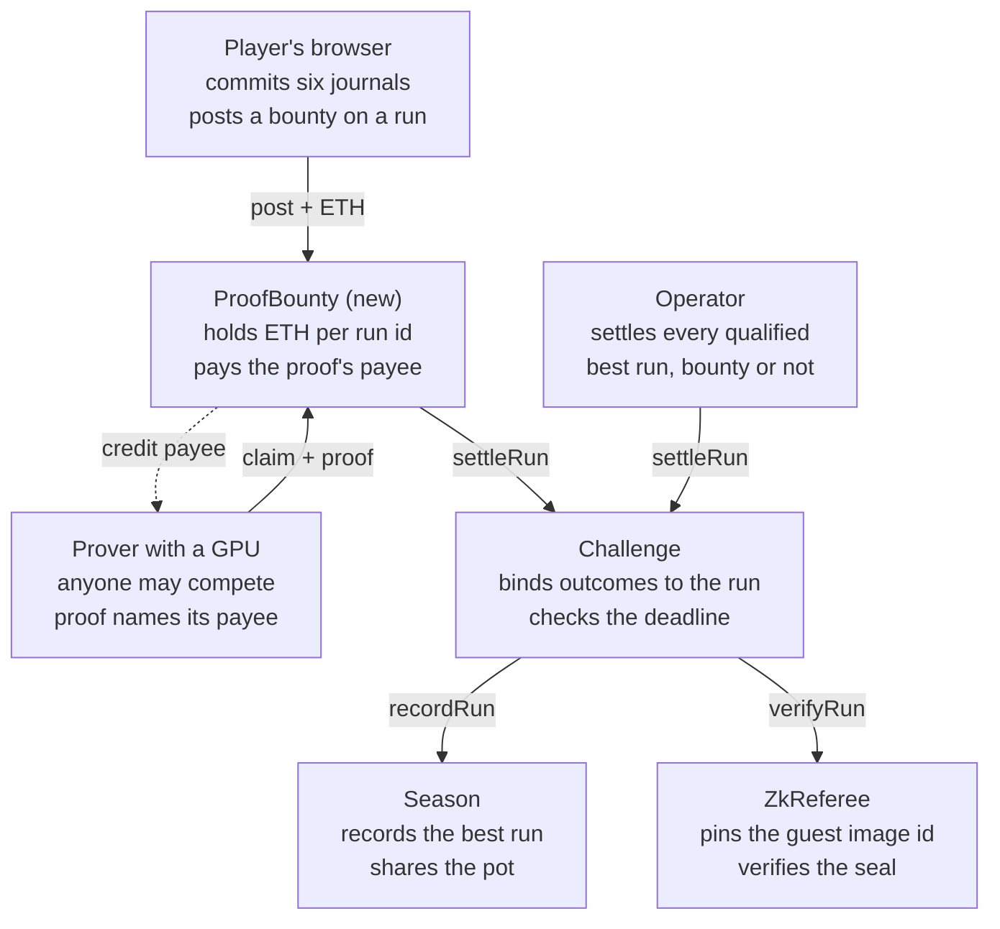

# Jiro-ikusu: verification review and proof-bounty design

As of 10 November 2026; corrected on 11 November 2026 after four rounds of independent review. The working notes are in [`notes/`](notes/README.md).

## 1. Summary

Keep the validity proof, move proving from a CPU to a GPU, and pay provers through a small escrow contract. Measure the GPU before building anything else. On 11 November the owner chose GPU proving, starting on a GPU rented online. Plan item M5.9 is the measurement, and pull request 91 moves it to a rented card.

- **The verification model is sound.** Journals are public, one core holds the rules, a contract checks a proof, and no signer is trusted.
- **The weight is in how proofs are made.** Only the operator proves, on a CPU. The largest run ever proven took about two hours. By the repository's own estimate, a whole bot run would take 9 to 17 hours, and none was ever proven.
- **A player cannot prove a run in the browser today.** No zkVM offers a browser prover whose proof Arbitrum can verify cheaply. A proof per level does not help: the work and the memory stay the same, and it is verified six times (section 5).
- **The planned fallback is gone.** The Boundless proof market stopped taking requests on 5 November 2026.
- **A GPU changes the picture.** Scaled from a third-party measurement of another program, a run of 100 million cycles would take about 1.5 minutes on an RTX 5090 (estimate). Nothing has been measured on this guest yet.
- **A GPU does not fix the economics.** Settling a run costs a quarter to a half of its fee in gas on Arbitrum One, above the 20% rake cap (estimate). No paid mainnet season should open until this is solved (section 11).
- **RISC Zero's emergency stop is a vendor risk.** One key outside the project can stop settlement for good (section 4, F4).
- **The proposed design is ProofBounty.** Anyone posts ETH on a run. Whoever presents a valid proof is paid at the address the proof itself names. The operator still settles every qualified best run.
- **Optimistic settlement was studied and rejected.** It saves 4 to 8% of a season pot and lets one missed watcher window lose all of it.
- **Agents can run the prover, and the escrow is the bounty.** MCP is a thin interface to the prover. x402 pays a server the client chose, in USDC, before the proof can be checked (section 9).
- **A home card or a rented consumer card proves a run of 100 million cycles for 1 to 3 US cents.** The cheapest AWS or Google machine costs two to three times more on demand. If a large cloud is required, Cloud Run fits single requests and spot machines fit batches (section 10). Cloudflare has no GPU for custom code, so it can only host the request API and queue (section 6).

The report gives the evidence for each point, the path that led to the design, and the decisions left to the owner. Section 13 lists those decisions, each with a recommendation.

Every figure is labelled by how it was obtained. Section 12 lists what is not verified.

## 2. Scope, method and evidence labels

The review ran on 10 November 2026 against the repository at commit `f52a60a` and changed nothing in it. File and line references are to that commit. It asked one question: is there a lighter, more practical way to verify that a player completed the levels, with fewer dependencies? The default branch has moved since: sections 4 and 13 say what that settles.

| Step | What was done | How it was checked |
| --- | --- | --- |
| Audit | Five readings of today's verification: trust, operations, cost, player experience, consistency of specification, code and tests | A second reviewer re-opened the cited files and tried to refute each finding |
| Measurement | Replay timing natively and in the browser build; RISC-V instruction counts with a scratch interpreter; a faster flood fill on a scratch copy of the core | Counts compared with the repository's recorded zkVM cycles: within 9% on each vector and 6% over the whole gate set, the repository's reference vectors |
| Research | Nine topics on alternatives, plus agents and cloud hosting, from primary sources read on the day | Decisive facts re-read by the lead or by a fact-checker |
| Design | Three independent optimistic designs, then the escrow specification | Red-team reviews, prototypes compiled and tested against copies of the real contracts |
| This report | Written on 10 November and reviewed on 11 November | Six reviewers checked it against the repository and the notes. A seventh re-checked their findings, and 40 corrections were applied. Three more then checked the corrected text, and two checked the copy in the repository. Five more then re-checked that copy, and a further reviewer tried to refute each of their findings |

Each figure in this report carries one of four labels.

| Label | Meaning |
| --- | --- |
| repo | Recorded in the repository's own documents or code |
| measured | Measured during this review on scratch copies of the code; the repository's code was not changed |
| third-party | Published by someone else and read on 10 November 2026 |
| estimate | Derived from the figures above; the arithmetic is in the working notes |

Three limits apply throughout. No GPU and no cloud account were available, so no proof was made on a GPU. A usage limit cut off one of the three red-team reviewers of the optimistic designs. Their final judge was not run. The web-search budget ran out during the precedent search.

## 3. How verification works today

A paid run counts only once a contract has checked a zero-knowledge proof that its public input journals produce the claimed result. The game is deterministic: a level is a pure function of the level bytes, a nonce from the chain and the journal.

1. **Pay.** `startRun` takes the 0.00005 ETH fee and commits to a future block hash.
2. **Reveal.** `revealRun` derives the run nonce, which draws six of the 16 levels.
3. **Play.** The browser records input changes only: one journal per level, at most 2,700 ticks and 8,171 bytes. Here a journal is the player's input log. What RISC Zero calls the journal, the guest's public output, is called the public values in this report.
4. **Commit.** `commitRun` publishes the six journals in calldata and stores their commitment. Anyone can replay them from then on.
5. **Settle.** `settleRun` hands the levels, journals and a proof to the season's referee. The contract binds the six outcomes to the run, checks the deadline and records the player's best run.
6. **Close and claim.** After the season end plus a grace period, settlement closes. The pot, minus the rake, is then shared by score among qualified best runs. A run qualifies by clearing at least the season's minimum number of levels, one by default. With none, the pot rolls over.

**The referee.** The same Rust core runs as the guest of the RISC Zero 3.0.6 zkVM and replays the journals. The prover cuts the execution into segments of about a million cycles, proves each, and wraps the result into a 260-byte Groth16 seal. `ZkReferee` pins the guest's image id, the hash that identifies the guest program, and calls RISC Zero's verifier through its emergency-stop wrapper.

**Who proves.** The specification says the operator rebuilds every committed run from chain data, then proves and settles each player's best run. Anyone else may settle, but in practice only the operator can. Its settle tool was written on 11 November, in plan item M5.5.

**The other backend.** A Stylus contract can re-execute the replay onchain with no prover. New Stylus activations have been paused on Arbitrum since 2 October 2026.

**Two reference runs.** This report uses two run sizes. A bot-style run uses the journals of the repository's playtest bots: 70 to 137 million zkVM cycles. A human-style run is six levels played like the repository's two human journals, quick clears by one player: 15 to 18 million cycles (estimate). Cost follows the captures, not the playing time. A cautious player who makes many small captures can need about 50 million cycles per level (estimate).

| Quantity | Value | Label |
| --- | --- | --- |
| Run fee | 0.00005 ETH, about 0.10 USD | repo |
| Cycles per run, human style | 15 to 18 million | estimate from two measured journals |
| Cycles per run, bot journals | 70 to 137 million | repo |
| CPU proving, 4 cores | 338 to 467 s per segment; 9 to 17 h per whole bot run; about 2 h per human-style run | repo rates; the hours are estimates |
| Memory | 9.2 GiB, then about 7 GiB for the Groth16 step in an x86 Docker image | repo |
| Onchain verification | 227,591 gas per proof | repo |
| Replay in the browser build, six heavy levels, with a state hash per tick | 0.12 to 0.19 s | measured |

## 4. Findings on the current design

The proof-to-run binding is complete and should be kept; the problems are in who can produce a proof, how long it takes and what happens when it does not arrive. Every finding below survived a second reviewer who re-opened the cited files.

**What holds**

- Every proven outcome is tied to the committed journal, the level, its weight, the run nonce and the draw (`contracts/src/ZkReferee.sol:78-94`, `contracts/src/Challenge.sol:241-260`).
- `ZkReferee` pins one image id and one verifier version, never RISC Zero's upgradeable router.
- Anyone may settle, and the credit always goes to the run's player.
- Journals are public from the commit, so anyone can replay any run for free.
- The referee is a per-season parameter, so a new backend needs no change to the money contracts. Deployment policy still redeploys all four contracts for a new image id.

**What does not hold**

| # | Finding | Evidence | Severity |
| --- | --- | --- | --- |
| F1 | Only short runs have ever been proven. The run settled on Arbitrum Sepolia was cut to 338 ticks. The largest run proof has 16 segments, the size of a human-style run; bot-style runs need 67 to 131. | `docs/DEPLOYMENT.md:173-178`, `docs/VERIFICATION.md:988` | High |
| F2 | Only the operator can prove in practice, and its settle tool is not written. An unsettled run scores nothing while its fee stays in the pot. | `docs/ECONOMY.md:84`, `scripts/contracts/season.mjs` | High |
| F3 | Proofs are not an exception. The pot is shared among settled best runs, so every player who expects a payout needs one. A player's best run is known only at the season's end. A prover that settles only best runs therefore works in the grace period. On a CPU one machine settles about two whole bot runs in a 24-hour grace period, and about 70 in the 30-day maximum (estimate). | `contracts/src/Season.sol:194-218` | High |
| F4 | RISC Zero's emergency stop is permanent and owned by one key outside the project. A stop after some runs settled gives them the whole pot; the deployment notes say it rolls over. | `contracts/src/Season.sol:196`, `docs/DEPLOYMENT.md:196`, onchain read | High |
| F5 | The image id, the root of trust, is typed in by hand at deployment. Reproducing it takes an hour-long build at one fixed path, and only the live end-to-end script compares it with the deployed referee. CI never does. | `scripts/contracts/deploy.mjs:197`, `referee/zk/README.md:58-67` | Medium |
| F6 | The documented maximum cost is a maximum over bot journals, not over legal journals. A cost-maximising run, scripted from one-cell captures, costs about 2.9 billion cycles, 22 times the heaviest documented run. Its journals do not clear a level as scripted. | measured; `docs/VERIFICATION.md:919-926` | Medium |
| F7 | The cost of a verified run was never paid or measured. The 69% figure adds a market price nobody paid to gas without Arbitrum's L1 data fee. | `docs/VERIFICATION.md:771`, `:933`, `:943` | Medium |
| F8 | Verification costs more than the rake that would pay for it. The rake is capped at 20% of a fee. | `contracts/src/Season.sol:44` | Medium |
| F9 | The documents understate the burden. The README's only proving time is about an hour, for six near-empty levels. The season page tells players to send the operator a run file, with no channel. | `README.md:590`, `web/src/pages/settle.ts:177` | Low |
| F10 | The contract accepts the referee's scores without bounds. The maxima in the README are properties of an honest core, not checks. | `contracts/src/Challenge.sol:262-266` | Low |

**Since the review.** Plan item M5.5 merged on 11 November and fixed two half-findings. The operator's settle tool now exists (F2), and the season page no longer asks players to send anything (F9). The tool also compares the image id with the referee before it proves. CI still never compares it with the source, so F5 stands. testnet-1 has 48 h of grace, in which a CPU settles two to five whole bot runs (repo). The runbook also has the operator settle the best runs so far on every day of the season, so that the grace only has to cover the last day's best runs. The owner chose GPU proving, and plan item M5.9 measures it, which will answer F1 and size F3. Pull request 91, still open, moves M5.9 to a rented card and records the owner's choice to rent. Until it merges, the plan names the RTX 3060. The other findings stand.

One finding is an opportunity. About 71% of the zkVM cycles are a single flood-fill loop. A 15-line rewrite of the same procedure cut the cycles by 54% on a scratch copy, with every vector trace unchanged (measured).

## 5. Can the player prove in the browser?

No. No zkVM offers a browser prover whose proof Arbitrum can verify cheaply, and a run is 50 to 90 times what one browser proof can hold.

| Route | What blocks it | Label |
| --- | --- | --- |
| The current RISC Zero proof | The prover is native code for CPUs and NVIDIA GPUs, with no browser build. The smallest proof ever made here, a level of one tick, took 21 to 36 minutes and 4.6 to 9.2 GiB, plus about 7 GiB for the final step. A 32-bit WebAssembly module, which browser provers use today, has at most 4 GB. | repo, third-party |
| Another zkVM | Every zkVM with a verifier on Arbitrum needs a final wrapping step of 7 to 16 GB on x86 or CUDA. The provers built for laptops and phones have megabyte proofs or no EVM verifier. | third-party |
| A hand-written circuit | It is a second implementation of the rules, which the owner excludes. A sizing model put a run at 109 to 187 million gates. The browser prover, run under Node's WebAssembly runtime, proved about 2 million gates in 82 s with 3.4 of its 4 GiB. | measured, estimate |
| One proof per level | Memory follows the segment size, not the program length, and the total work is the same. It costs six verifications instead of one. | repo |

The Ethereum Foundation's client-side proving benchmark supports this. On an Apple M1 the largest zkVM workload it measures is about 0.6 million cycles, roughly one capture tick of this game. RISC Zero needs 18.5 s and 1.47 GB there for a program of 5 thousand cycles (third-party).

No shipped project was found that proves a real-time replay of this size in a browser. The one that advertises it, an Arkanoid on Mina, ships placeholder proofs in its browser worker. This search ran out of budget, so it is weak evidence.

What the browser can do today is replay. The existing build replays the heaviest six-level run and hashes the state after every tick in under 0.2 s (measured). A single tick, about half a million cycles, is within reach of client-side provers; a whole run is not.

## 6. Options considered

Eleven options were examined; two are kept, one is held in reserve and eight are dropped. The owner's constraints decided most of them: one implementation of the rules, no trusted signer, few dependencies.

| Option | What it changes | Trust added | State on 10 November 2026 | Verdict |
| --- | --- | --- | --- | --- |
| A. CPU proving by the operator (today) | Nothing | None | 9 to 17 h per whole bot run (repo estimate); only the operator proves | Not workable beyond a few players |
| B. GPU proving, same proof | One build feature; no contract change | None | About 1.5 min on an RTX 5090 and 6 to 9 min on an RTX 5060 Ti, per bot-style run (estimate from third-party figures); unmeasured here | **Keep**, after measuring |
| C. ProofBounty escrow | One public word in the proof, one small contract | None: a proof is still checked | Prototyped and red-teamed; 152 lines, 84 tests | **Keep** for testnet, beside operator settlement |
| D. Hosted proof market (Boundless) | Nothing | None | Closed to new requests on 5 November 2026 | Gone |
| E. Another zkVM | New guest wrapper, referee and tooling trial | None | Only SP1 and OpenVM have a production path to an Arbitrum verifier. SP1's network sells a proof for about 0.078 USD, 76% of a fee | Reserve: keep the SP1 trial branch |
| F. Optimistic claims, proof on dispute | Claims, bonds, challenge windows | An honest watcher in every window | Three designs, two prototyped | Dropped after red team |
| G. Stylus re-execution | None, the referee exists | None | Activations paused; a permissioned reopening not before mid-December 2026, more likely early 2027, and not assured; 13 to 20 times the fee per run | Not available |
| H. Dispute narrowed to one tick | New consensus code to restore a state, a dispute game | An honest watcher | Not built | Too much new surface |
| I. Browser proof or hand-written circuit | See section 5 | None | Not feasible | Dropped |
| J. Attestation: TEE, oracle network, signature | Replaces the proof | A signer | TEE attestations forged in labs; Chainlink Functions retired | Excluded by constraint |
| K. Proving on Cloudflare | Hosting only | None | No GPU for custom code; containers stop at 4 vCPU and 12 GiB (third-party); about 0.6 to 7 USD per run on CPU (estimate) | Use it for the request API and queue only |

**Why optimistic settlement was dropped.** Three designers converged on the same shape: the browser posts the result, anyone may challenge for 36 to 96 hours, and a challenged claim survives only with today's proof. Two red-team reviews found that a forger who commits unprovable journals wins whenever one window passes unwatched. In two designs an honest player loses a bond when no proof arrives in time. Against GPU proving, the saving is 4 to 8% of a season pot.

**Why another zkVM is only a reserve.** An Ethereum block is about the size of a run here. On the Ethproofs benchmark the leading zkVMs prove one in 2 to 7 seconds, on one to sixteen RTX 5090 cards. Switching would save about a minute per proof over RISC Zero on a GPU and cost the whole zk milestone again. It becomes the fallback if RISC Zero is no longer maintained.

## 7. Conception process

The design was reached in eleven steps over two days, each triggered by a question from the owner or by a finding. The table is in the order things happened, so a reviewer can see which fact moved the design.

| # | Trigger | What was learned | Effect on the design |
| --- | --- | --- | --- |
| 1 | Owner: is there something lighter, and could the player prove in the browser? | A run is 70 to 137 million zkVM cycles and takes hours on a CPU. The browser replays it in under 0.2 s. | Audit, research and measurements started. First candidate: let the browser claim and prove only on dispute. |
| 2 | Owner: could we prove per level? | Memory and total work do not drop, and verification is paid six times. One level is enough to prove a dispute. | Per-level proofs kept only as a dispute tool. |
| 3 | Owner points to the Ethproofs benchmark | GPU provers prove workloads of this size in seconds. The hours here come from proving on 4 CPU cores. | New option: keep the proof, change the hardware. Research sized RISC Zero on one GPU. |
| 4 | Owner: host a paid proving service on Cloudflare? | Cloudflare has no GPU for custom code. The service itself is what README section 7.5 already plans. | Cloudflare kept as front door only. Payment proposed as pay on delivery through an onchain escrow. |
| 5 | Owner: has an RTX 3060 at home, an agent to run it, and wants open competition | The Boundless market, the only hosted source of these proofs, had just closed. | Own prover plus an open bounty becomes the main route, not an option. |
| 6 | Owner: will buy an RTX 5060 Ti; proofs must not be front-run | Arbitrum has no public mempool, but a reverted transaction publishes the proof. Groth16 seals can be re-randomized. | The proof names its payee. The escrow pays on presentation and once per run id. |
| 7 | Audit completes | Ten verified findings (section 4), among them that only short runs were ever proven. A human-style run is about a sixth of the documented size. | Measuring the GPU becomes the first work item. Gas, not proving, becomes the main cost. Document corrections listed. |
| 8 | Red team on optimistic settlement | One unwatched window pays a forger; honest bonds can be lost on a timeout. | Optimistic settlement dropped. |
| 9 | Escrow specified, prototyped and attacked from three sides | No theft path. A poster who can prove their own run can cancel a bounty and waste the prover's time. | Operator keeps settling best runs; refund on a stopped verifier; a cap per run; a lock with a stake required before mainnet. |
| 10 | Owner asks for this report, with agents and cloud hosting | MCP is only an interface. x402 is a checkout, not a bounty. Home and marketplace GPUs cost less than the large clouds. | The escrow stays the bounty and hosting starts at home. Decisions are listed in section 13. |
| 11 | Owner: the home machine runs x86-64 Linux, but the project starts on a GPU rented online | Rented and home cards cost about the same per proof. A rented card needs no set-up at home and takes the 12 GB question out of the first measurement. | Work item 1, now plan item M5.9, runs on a rented card once pull request 91 merges. The home card can follow, with a bigger card if needed. |

Two things changed direction more than any analysis did. The Ethproofs pointer showed that the cost was a property of the hardware, not of the problem. The closure of Boundless removed the fallback every earlier plan assumed.

## 8. The proposed design

Keep the proof exactly as it is, produce it on a GPU, and let anyone be paid for producing it through an escrow that pays only the address the proof names.

A bounty is paid only to the address the proof names. If no proof arrives before settlement closes, each deposit returns to its depositor.

A player posts ETH on a run id. A prover builds the proof with its own payee address inside, and calls `claim`. The escrow settles the run through the unchanged `Challenge`, so the score still goes to the player. It then owes the bounty to that payee, whoever sent the transaction.

**Front-running.** Arbitrum has no public mempool: the sequencer orders transactions before it publishes them. A reverted claim or a gas estimate can still expose a proof. A copier gains nothing, because the payee is inside the proof and a run pays only once.

**GPU proving.** The host gains RISC Zero's `cuda` build feature. The guest, the image id, the seal and the contracts do not change. It needs x86-64 Linux, an NVIDIA card and the CUDA toolkit; the Groth16 step then runs on the GPU without Docker (third-party). Cards with 16 GB or more fit the default settings; 8 to 12 GB cards need smaller segments (third-party guidance).

**Proof format.** The guest commits one more 32-byte word at the end of each proof: the payee. Public values grow from 384 to 416 bytes for a level proof and from 2,304 to 2,336 for a run proof. This changes the image id once. `RULES_VERSION`, `Challenge`, `Season` and `IReferee` stay as they are. The core changes only by the faster flood fill of section 4, which moves no vector.

**Escrow rules**

| Rule | Reason |
| --- | --- |
| `claim` credits the payee named in the proof, never the caller | A copied proof is worthless to whoever copies it |
| Deposits only on runs whose season settles through the escrow's own `ZkReferee` | Only that referee checks the seal against the public values that hold the payee. The mock and Stylus referees do not |
| One payout per run id, never per proof | A Groth16 seal can be re-randomized into other bytes; verified on a real seal (measured) |
| A claim settles an unsettled run, and still pays on a run someone else settled | Copying a proof and settling directly cannot starve the prover |
| Deposits only on committed, unsettled runs; nothing reduces a bounty before its refund date | A prover that saw a price finds at least that price at delivery |
| Refund when settlement closes unsettled, or at once if RISC Zero's verifier is stopped | No proof can pay after either event |
| Refund of an unclaimed bounty 7 days after settlement closes | Otherwise ETH is locked for good when a run was settled another way |
| A bounty is capped at 4 run fees | Bounds what unaudited code can strand. Four, not two, leaves room for slow runs on the RTX 3060. The cost-maximising run can still cost more than four fees of power there (estimate) |
| Credit first, withdraw separately | A payee that rejects ETH cannot block a settlement |

**What three red-team reviews changed.** None found a way to steal a bounty. Their main additions follow. The operator keeps settling every qualified best run, so settlement is not only something players buy. Refunds open as soon as the verifier is stopped, and a bounty is capped. The prover schedules its own obligations first, counts its whole queue against deadlines and stops when a bounty is paid. It checks each run file against chain data, and the host refuses a payee without a checksum. The payee should be a cold address or a Safe, never the hot key that pays gas. A lock with a stake is required before mainnet.

**The lock with a stake.** It would let one prover reserve a funded run for a set time. The prover posts a stake and loses it if no proof arrives in time. Rivals then stop racing, and a poster cannot claim its own bounty during the lock. It adds a second state machine, so it is left out of the testnet version.

**Residual risks**

| Risk | Position |
| --- | --- |
| A poster who can prove its own run can claim its own bounty and waste a prover's time | Acceptable on testnet with the scheduling rules; needs the lock before mainnet |
| A few funded runs of billions of cycles, for 2 to 3 USD, can keep the one GPU busy near the deadline | Own runs first, queue-aware deadlines, a cycle cap late in the grace period |
| Two provers race and the slower loses its work | Accepted until the lock exists |
| A bounty on a run already settled outside the escrow pays for a later, useless proof | Every tool settles a funded run through `claim`. The depositor gets a refund 7 days after settlement closes |
| A deposit stays locked until settlement closes, even when no proof can exist | The web app replays the run before a player posts |
| One prover, at home or rented, and one sequencer are single points of failure near the deadline | Longer grace, settling during the season, health alerts |
| Settling a human-style run costs about a quarter of a run fee in gas on Arbitrum One (estimate) | Not solved by the escrow; see section 11 |
| Unaudited contract holding users' ETH | Testnet only, capped per run |

**Status.** The contract is prototyped: 152 lines, 84 new tests and five invariants passing against copies of the real contracts (measured). The prototype does not yet have the cap per run or the refund on a stopped verifier; they add about 15 lines. The guest and host changes were not compiled. A claim on a human-style run costs about 590,000 gas (estimate from the prototype).

## 9. Agents: MCP and x402

An agent can run the proof through MCP, and that is cheap to add. x402 pays one server the client chose, so it is not a bounty; the escrow of section 8 is the bounty, and autonomous agents can already compete on it.

### Could the player have the proof run by an agent through MCP?

Yes. MCP gives agents a standard way to call the prover. It does not pay anyone and does not decide whether a proof is valid: that stays with the onchain check.

| Shape | Who uses it | How it meets the escrow | Size |
| --- | --- | --- | --- |
| A local MCP server wrapping the prover binary | The owner's supervising agent; any owner of an NVIDIA card | The agent's script watches bounties, proves with its own payee and calls `claim` | Small |
| A remote MCP server in front of the operator's GPU, with `quote`, `prove` and `status` tools that take a run id | A player's assistant | The operator proves, then claims with its own payee or settles for free | Medium |
| Third-party autonomous agents | Anyone | They run the local server on their own card and race on the escrow | No extra work once the first is published |

Four rules keep this safe.

- **A job id, not a long call.** A proof takes minutes. `prove` returns a job id and `status` is polled. The current MCP revision (2026-07-28) is stateless, and its Tasks extension is not yet confirmed in any major client (third-party).
- **No key in the model's context.** A deterministic script proves, simulates the transaction and signs. The agent starts, stops and watches it.
- **A run id is the only input.** The server rebuilds the journals from the chain. Journals are bytes chosen by a stranger.
- **Limits.** Cap the cycles per job, refuse duplicates and rate-limit callers.

### Could it be a bounty for autonomous agents through x402?

Not by itself. x402 is a checkout: a client pays a server it picked, per HTTP call.

| Property | x402, exact scheme | ProofBounty |
| --- | --- | --- |
| Who is paid | The server the client chose | Whoever presents a valid proof first |
| When | The server works, settles, then answers. The client has paid before it can check the proof, and there is no refund | In the transaction that verifies the proof onchain |
| Currency | USDC or another ERC-20, signed with EIP-3009 or Permit2. Native ETH is not offered | Native ETH, the unit of the run fee |
| Chain | Arbitrum One through Coinbase's hosted facilitator. No hosted facilitator lists Arbitrum Sepolia, though some list only "EVM"; a self-hosted one can | Wherever it is deployed |
| Cost of one payment | 0 to 0.001 USD hosted; about 0.003 to 0.004 USD self-hosted | About 0.004 USD to post and 0.002 USD to withdraw (estimate) |
| What is trusted | The server | The verifier contract and the escrow code |
| Copied proofs | No protection | The payee is inside the proof |

x402 has an escrow-like scheme, but its contracts are not deployed on Arbitrum, and the server decides its release, not a proof. All x402 facts were read from the specification, Coinbase's documentation and the published packages on 10 November 2026, then re-checked by a second reader.

**Where x402 could fit later.** An optional priced endpoint for players who would rather pay USDC per call than post a bounty. It would prove, simulate `verifyRun`, and charge only then. By default the x402 package for MCP waits 60 s for payment and caps a call at 600 s. Both can be raised, but the call must stay open for the whole proof. Whether the package works with the current MCP revision was not verified. This belongs after the mainnet economics are settled.

**What a third-party agent needs to earn.** On a rented RTX 5090 a bounty must reach about 0.03 to 0.04 USD for a human-style run and about 0.07 USD for a bot-style run (estimate). That holds for one warm prover with no rival: with several racing, the losers' GPU time is lost. The cost-maximising run of section 4 would cost about 0.48 USD of GPU time, more than the cap of four run fees.

**Identity and discovery.** The ERC-8004 agent registries exist on Arbitrum One and Sepolia. They are not needed: the escrow trusts the proof, not the prover's reputation. They would only help agents find the endpoint.

**Recommendation.** Do not use x402 as the bounty. Build the local MCP wrapper for the owner's agent first, publish it for other GPU owners second, and add a free, rate-limited remote endpoint third. All three wait on the GPU measurement. With a rented card, the owner's agent starts the machine, runs the prover there and stops it. The signing key stays off that machine.

## 10. Cloud hosting benchmark

Per proof, a home card and a consumer card rented on a marketplace cost about the same: one to three US cents for a bot-style run. The cheapest AWS or Google virtual machine costs two to three times more on demand. On spot capacity, which can be interrupted, it comes close to marketplace prices. If a large cloud is required, Google Cloud Run fits single requests and spot L4 machines fit batches.

No instance was started for this benchmark. Prices were read from each provider's own page or API on 10 November 2026 (third-party). Every proving time is an estimate, scaled from third-party measurements of other programs.

**Owner's decision of 11 November.** The project starts on a GPU rented online. This report recommends renting it by the hour. The owner's RTX 3060 machine runs x86-64 Linux and can take over later, with a bigger card if needed. The ranking below is the benchmark's own; the decision is marked where it applies.

**How the figures were built**

- **Two reference runs.** A human-style run of 16 million cycles and a bot-style run of 100 million cycles, as in section 11.
- **One reference speed.** RISC Zero 3.0.6 on an RTX 5090: 0.57 s per segment, 0.33 s of recursion per segment and 2 s for the final step. That gives 88 s for a bot-style run and 16 s for a human-style run.
- **Other cards.** The L4 uses a third-party measurement of its own. The others are scaled by published memory bandwidth and arithmetic throughput, and their ranges are wide on purpose.
- **Cold starts.** 60 s billed on serverless and 300 s on a virtual machine. These are assumptions.
- **Rates of the day.** 1 ETH = 2,050 USD and 1 EUR = 1.12 USD, so the run fee is 0.10 USD.

### Estimated proving time by card

| Card | Memory | Bot-style run | Human-style run | Basis |
| --- | --- | --- | --- | --- |
| RTX 5090 | 32 GB | 1.5 min | 16 s | Estimate from a third-party measurement of another program |
| RTX PRO 6000 (Blackwell) | 96 GB | 1.3 to 2 min | 15 to 23 s | Estimate from specifications |
| RTX 4090 | 24 GB | 2.2 to 2.8 min | 24 to 31 s | Estimate from third-party logs |
| L40S | 48 GB | 1.6 to 4.2 min | 18 to 47 s | Estimate from specifications |
| H100 | 80 GB | 1.3 to 4.2 min | 15 to 47 s | Estimate from specifications |
| L4 | 24 GB | 2.4 to 2.7 min | 27 to 30 s | Estimate from one third-party measurement of another program |
| A10, A10G | 24 GB | 4.4 to 6.9 min | 49 to 76 s | Estimate from specifications |
| A100 | 40 or 80 GB | 1.8 to 11 min | 19 to 122 s | Estimate, very wide |
| RTX 5060 Ti | 16 GB | 5.8 to 9.1 min | 65 to 101 s | Estimate from specifications |
| RTX 3060, smaller segments | 12 GB | 9.5 to 22 min | 1.8 to 4.1 min | Estimate from specifications |
| T4 | 16 GB | 8 to 26 min | 1.5 to 4.9 min | Estimate from specifications |

The cost-maximising run of section 4, 2.9 billion cycles, would take about 41 minutes on an RTX 5090 and 3 to 10 hours on the two home cards.

### Cost per proof

| Option | GPU | USD per hour | Bot-style run, in a batch | One human-style proof, from cold | 1,000 bot-style runs |
| --- | --- | --- | --- | --- | --- |
| Home, owned card | RTX 3060 | electricity | 0.011 to 0.031 | 0.002 to 0.006 | 11 to 31 |
| Home, planned card | RTX 5060 Ti | electricity, plus the card | 0.007 to 0.014 | 0.001 to 0.003 | 7 to 14 |
| RunPod pod, community | RTX 4090 | 0.34 | 0.012 to 0.016 | 0.03 | 12 to 16 |
| RunPod pod, community | RTX 5090 | 0.69 | 0.017 | 0.06 | 17 |
| Vast.ai, median offer | RTX 5090 | 0.83, or 0.53 interruptible | 0.020 | 0.07 | 20 |
| Vast.ai, median offer | RTX 5060 Ti | 0.14 | 0.014 to 0.022 | 0.015 | 14 to 22 |
| RunPod Serverless | RTX 5090 | 1.79 | 0.044 | 0.038 | 44 |
| Modal | L4 | 1.12 | 0.05 | 0.03 | 45 to 51 |
| Google Cloud Run, zonal redundancy off | L4 | 1.05 | 0.04 to 0.05 | 0.03 | 42 to 47 |
| Google Cloud Run, zonal redundancy off | RTX PRO 6000 | 3.19 | 0.07 to 0.11 | 0.07 | 70 to 109 |
| Google Compute Engine g2-standard-4 | L4 | 0.71, or 0.42 spot | 0.03 | 0.06 | 29 to 32 |
| Google Compute Engine g4-standard-48 | RTX PRO 6000 | 4.50, or 1.72 spot | 0.10 to 0.15 | 0.39 to 0.40 | 99 to 154 |
| AWS g6.xlarge | L4 | 0.80, or about 0.59 spot | 0.03 to 0.04 | 0.07 | 33 to 36 |
| AWS g4dn.xlarge | T4 | 0.53 | 0.07 to 0.23 | 0.06 to 0.09 | 72 to 230 |
| AWS g7e.2xlarge | RTX PRO 6000 | 3.36, or about 2.01 spot | 0.07 to 0.11 | 0.29 to 0.30 | 74 to 115 |
| Azure NC4as\_T4\_v3 | T4 | 0.53, or 0.16 spot | 0.07 to 0.23 | 0.06 to 0.09 | 72 to 230 |
| Azure Container Apps, serverless | A100 | 2.94 | 0.09 to 0.54 | 0.06 to 0.15 | 86 to 537 |
| Lambda | A10 | 1.29 | 0.09 to 0.15 | 0.13 | 94 to 148 |
| Hetzner GEX45, dedicated | RTX PRO 4000 | 0.38, plus 234 of set-up | 0.04 to 0.06 | not applicable | 38 to 57, plus set-up |

Costs are in USD at on-demand prices (estimate). "In a batch" means the machine is already running. "From cold" means one request that also pays the start-up. The last column is one machine kept busy with bot-style runs; a season of human-style runs costs about a sixth of it. Home rows count the whole PC, at 1.5 to 1.8 times the card's rated power and 0.25 EUR per kWh (estimate).

Three cautions apply to the prices. Marketplace medians moved by up to a quarter within the hour. AWS spot prices come from a price tracker. Cloud Run turns zonal redundancy on by default, which brings the two rows to 1.42 and 3.92 USD per hour. Zonal redundancy reserves GPU capacity in more than one zone.

### What each offer involves

| Family | Billing | Scales to zero | Before the first proof | Interruption |
| --- | --- | --- | --- | --- |
| AWS EC2 | Per second, 60 s minimum | No | A quota request: new accounts start at zero GPU instances | Spot gives a two-minute warning |
| Google Compute Engine | Per second after one minute | No | GPU quota for the machine type; the default was not found | Spot gives no notice by default |
| Google Cloud Run | Per second, for the instance's lifetime | Yes | 3 GPUs of quota granted at the first deployment, with zonal redundancy off | None |
| Azure virtual machines | Not read | No | Quota not read | Spot prices are published; the notice was not read |
| Azure Container Apps, serverless | Per second | Yes | T4 and A100 quota is on by default for pay-as-you-go accounts | None |
| RunPod pods | Per second | No: stop the pod | An account and credit | Community hosts may be less reliable |
| RunPod Serverless | Per second; the image pull is not billed | Yes | An account and credit | None |
| Vast.ai | Per second | No | An account and credit; host quality varies | Interruptible offers can be outbid |
| Modal | Per second | Yes | A payment method | None |
| Lambda, DigitalOcean | Per minute; per second with a five-minute minimum | No | Self-serve | None published |
| Hetzner dedicated | Monthly or hourly, plus a set-up fee | No | Order a server | None |
| Home GPU | Electricity | Always on | Nothing for the RTX 3060 | Power, network, one machine |

### What the benchmark shows

- **The card matters more than the vendor.** In a batch, every option costs cents per run. A home card costs 0.007 to 0.031 USD of electricity per bot-style run, and a marketplace card 0.012 to 0.022 USD. The large clouds' cheapest usable GPU, the L4, costs 0.03 to 0.04 USD on demand.
- **A single proof pays mostly for start-up.** A cold human-style proof costs 0.03 to 0.07 USD on most serverless offers. On a large cloud's virtual machine it costs 0.06 to 0.40 USD. The proving itself costs 0.003 USD on a rented RTX 5090.
- **AWS and Google Compute Engine are the slowest to start.** A new AWS account has a quota of zero GPU instances. Beyond the T4, A10G and L4, their single-GPU machines cost 1.9 to 6.9 USD per hour.
- **Google Cloud Run suits single requests.** It scales to zero, bills per second and grants GPU quota at the first deployment, once zonal redundancy is turned off. For a batch it costs more than a spot L4 machine.
- **Serverless timeouts must be raised.** By default RunPod stops a job after five or ten minutes and Cloud Run after five. Cloud Run allows one hour at most. On an L4 that is too short for the cost-maximising run, which needs 1.1 to 1.3 hours (estimate).
- **An always-on rented GPU does not pay.** A marketplace RTX 5060 Ti costs about 100 USD per month, and a RunPod RTX 4090 costs 245 USD. At the bounty cap of 0.41 USD, that takes 250 to 600 bounties a month.
- **No card meets a ten-minute response time on the cost-maximising run.** It needs about 41 minutes on an RTX 5090. Any promised response time must scale with the run's cycles.
- **Against the fee.** A human-style run proven cold on serverless costs 0.03 to 0.07 USD of GPU time plus about 0.027 USD of gas. That is 50 to 100% of the fee. In a marketplace batch the total is about 0.03 USD. At home it is gas plus a fraction of a cent.

### The two home cards

|  | RTX 3060 12 GB, owned | RTX 5060 Ti 16 GB, planned |
| --- | --- | --- |
| Price | Owned | About 620 to 800 EUR on two price trackers (third-party) |
| Segment size | Half the default, probably required | The default; half if the final step runs out of memory |
| Bot-style run | 10 to 22 min | 6 to 9 min |
| Human-style run | 2 to 4 min | 1 to 2 min |
| Cost-maximising run, 2.9 billion cycles | 4.5 to 10 h | 2.7 to 4.3 h |
| Electricity per bot-style run, whole PC | 0.010 to 0.028 EUR | 0.007 to 0.012 EUR |
| 1,000 bot-style runs | 7 to 15 days | 4 to 6 days |

Electricity is counted at 0.25 EUR per kWh, for the whole PC at 1.5 to 1.8 times the card's rated power (estimate). An earlier, rougher estimate put the previous card of this class at 8 to 15 minutes per bot-style run.

Against renting, the RTX 5060 Ti saves at most about one cent of power per run. It pays for itself after about 50,000 runs at best, and perhaps never against the cheapest marketplace cards (estimate). Its case is latency and independence, not cost. Renting one on Vast.ai at 0.14 USD per hour measures it before buying.

### Ranking by scenario

| Scenario | First choice | Second choice | Avoid |
| --- | --- | --- | --- |
| A testnet season of a few tens of runs | A marketplace RTX 4090 or 5090 rented by the hour, for example on RunPod: about 1 USD in total. Renting is the owner's choice | The owned RTX 3060, once it is measured | AWS, for its quota request; A100 and H100 machines |
| 1,000 runs per season | The home card proving through the season, as runs are committed: 7 to 31 USD of electricity for the whole PC (estimate) | Several marketplace pods in parallel for the last days: 12 to 24 USD. Spot L4 on Google or AWS if a large vendor's invoice is needed: 17 to 27 USD | Proving everything during the grace period on one card |
| Bounties served within 10 minutes at any hour | The home card, always on. The RTX 3060 meets it for human-style runs only | A serverless endpoint for overflow: RunPod Serverless RTX 5090 at 0.04 to 0.07 USD per request, or Cloud Run RTX PRO 6000 at 0.07 to 0.16 USD | Always-on virtual machines, at 380 to 5,000 USD per month |

For the two other scenarios the rented start changes the order, not the costs. A pod started once a day proves the runs committed so far, for 12 to 24 USD per 1,000 bot-style runs plus 0.03 to 0.07 USD per start (estimate). Bounties at any hour need a card that stays warm or a serverless endpoint, so that choice comes with the escrow.

### What hosting involves, whatever the provider

- **One image.** Build the prover once at the repository's fixed path, with the GPU kernels compiled ahead for each card generation and the Groth16 files inside. It is about 8 GB (estimate). Pin it by digest and compare its image id with the contract before proving.
- **No secret on the GPU machine.** A proof is public data and names its payee. The key that pays gas stays in a separate small submitter with a capped balance.
- **All or nothing.** The prover saves nothing until the proof is complete. An interruption loses the run, so spot capacity suits only short runs that can be queued again.
- **Negligible data transfer.** Inputs and outputs are kilobytes. Only the image pull is large.
- **A rented host is not trusted.** It sees only public inputs and cannot forge a result. At worst it withholds a proof, or claims a bounty with its own payee as any rival could. The repository is public, so the machine needs no credential at all.

### Measuring before choosing

About 3 USD of rental measures this guest on the cards that bracket the decision. This extends plan item M5.9 as pull request 91 writes it: one rented card, with the prover built on that machine. A prebuilt image is a later saving.

1. Build the image once, off the rented machines, and check its image id against the deployed contract.
2. Rent an RTX 5090 on RunPod, an L4 on Google Cloud, and an RTX 5060 Ti and an RTX 3060 on Vast.ai, for one to three hours each.
3. On each, record the machine and time the cold start. Prove the two committed runs that pull request 91 gives M5.9, three times each. On the RTX 5090, add one run of about a billion cycles.
4. Record seconds per stage, peak GPU memory, host memory and power. Try the smaller segment size on the 12 and 16 GB cards.
5. Verify one seal per card on Arbitrum Sepolia.
6. Write the table into the verification notes and recompute this section.

### Not verified in this section

- Any proving time on this guest, and the factor applied to each card. The L4 figure assumes that one third-party measurement carries over.
- Cold-start times, and whether a 12 GB card holds the smaller segments together with the final step.
- Fractional GPUs on AWS, Google and Azure.
- AWS spot prices, which come from a price tracker, and Google's prices for its larger machines, which the second reader could not re-read.
- The default GPU quota of a new Google Cloud project, and Azure's.
- The longest request that Azure Container Apps allows.
- The RTX 5060 Ti's price: two trackers give 617 and 799 EUR.

## 11. Economics

Once proving moves to a GPU, the cost of a settled run is almost all gas. On Arbitrum One that is a quarter to a half of a run fee, more than the largest rake the contract allows.

| Cost of one settled run | Human-style run, 16 million cycles | Bot-style run, 100 million cycles | Label |
| --- | --- | --- | --- |
| Gas, direct settlement | 530,256 | 804,194 | repo |
| Gas, through the escrow | about 590,000 | about 930,000 | estimate from the prototype |
| Same, in ETH on Arbitrum One on 10 November | 0.000012 to 0.000014, 25 to 27% of the fee | 45 to 51% of the fee | estimate |
| Proving on a rented RTX 5090 at 0.83 USD per hour, in a batch | about 0.004 USD | about 0.02 USD | estimate from third-party speeds |
| Proving on a home card | under 0.01 EUR of electricity | 0.007 to 0.03 EUR | estimate, whole PC |
| Proving on 4 CPU cores | 1.5 to 2.1 hours | 9 to 12.5 hours | estimate from the repo's rates |

On Arbitrum Sepolia the L1 data component is priced at zero, so testnet costs are near nothing. Section 10 compares where the proving itself can run.

**Who pays.** There are three models.

| Model | What it takes | Weakness |
| --- | --- | --- |
| The operator settles every qualified best run from the rake | The rake is 0.000005 ETH per paid run at 10% and 0.00001 ETH at the 20% cap. One settlement needs 1.2 to 2.7 paid runs per player. | The operator loses money on players who play once |
| The player posts a bounty | About 0.000015 to 0.00002 ETH, 30 to 40% of a fee (estimate) | A low scorer's share is worth less than the bounty, so they stop settling and their fees go to others |
| Both: operator settlement, with bounties as an open second path | The first model's cost, plus the escrow | Recommended for testnet; mainnet still needs one of the levers below. With one prover, a bounty mostly pays the owner for a settlement the operator already owes |

**Levers for mainnet.** None is designed in this report.

- Raise the fee, or the rake up to its cap.
- Settle fewer runs, for example with a higher qualification threshold.
- Send hashes instead of level and journal bytes at settlement. This saves 5% of the gas for short journals and up to 44% for long ones, and needs a new `Challenge`.
- Verify one aggregated proof per season. The repository measured about 8,400 gas per run plus 279,000 per batch, against 227,591 per run. Its proving side was never run, and runs would settle only once the season's batch is proven. The owner chose no aggregation for testnet, and the README reconsiders it before mainnet.

The faster flood fill of section 4 halves proving time. It does not change gas.

## 12. Risks and what is not verified

The largest unknown is the GPU proving time on this guest: every price, deadline and grace period in this report depends on it, and nobody has measured it.

| Not verified | Why it matters | How to close it |
| --- | --- | --- |
| GPU proving time and memory on this guest | Sets prices, the grace period and whether a 12 GB or 16 GB card is enough | Plan item M5.9, as pull request 91 writes it, proves two committed runs on a rented card |
| The prover machine's operating system | The CUDA prover needs x86-64 Linux; Windows is not supported | Closed: the owner confirmed x86-64 Linux on 11 November |
| The payee change in the guest and host | It was not compiled; the new layout was tested only against RISC Zero's mock verifier | Build it and prove two fixtures again |
| Who maintains RISC Zero and holds its emergency-stop key | A stop is permanent and halts settlement. The last stable release is from July 2026; Boundless has left proving | Ask the vendor, watch releases, keep the SP1 branch as a fallback, decide whether to pin an own verifier |
| Arbitrum's L1 data fee on a real settlement | The quarter-of-a-fee figure is an estimate from chain reads | Measure on a fork of Arbitrum One |
| The cost-maximising run on a real zkVM | The 2.9 billion cycles come from a scratch interpreter and one scripted policy | Run it through the executor; decide whether to bound capture work in the core |
| The Stylus vote | The temperature check passed 57.3% to 42.7%; the onchain vote is not submitted | Watch it; no action |
| Third-party GPU figures | They come from other cards, a fork's benchmark suite and other guests | Covered by the first item |
| The precedent search | The search budget ran out, so "none found" rests on few searches | Low impact |
| The optimistic verdict | Two of three red-team reviewers finished and agree; the final judge was not run | Low impact |

Three risks stay whatever is measured.

- **Vendor.** The proof system is RISC Zero's. If its verifier is stopped, later seasons need a referee pinned to another verifier. If the software is abandoned, bugs go unfixed and the fallback is another zkVM.
- **Liveness.** With one prover, at home or rented, a failure near a deadline leaves runs unsettled. A rented card also depends on the provider's supply at that hour. A longer grace period, settling during the season and a second provider reduce it.
- **Legal.** A paid proving service around a prize game belongs in the legal review already listed as a pre-mainnet prerequisite.

## 13. Decisions for the owner

Four decisions can be taken now, six wait for the GPU measurement, and five must be settled before any mainnet season. Each carries a recommendation.

**Decided so far.** On 11 November the owner chose GPU proving with a 48 h grace for testnet-1, in round G2 of the plan. The owner then chose to start on a GPU rented online. The owner's RTX 3060 machine runs x86-64 Linux and can take over later, with a bigger card if needed. Decisions 1, 2 and 9 are therefore taken, and plan item M5.5 wrote the settle tool of decision 4.

**Now**

| # | Decision | Recommendation | Why |
| --- | --- | --- | --- |
| 1 | Direction: keep the validity proof and move proving to a GPU | Yes. Taken on 11 November: GPU proving | Optimistic settlement failed its red team, another zkVM costs the zk milestone again, and Stylus is closed (section 6) |
| 2 | Measure before building: work item 1, on a GPU rented online as the owner decided. It needs an account at a GPU marketplace. The owner's RTX 3060 can be measured later | Yes, first. Taken: plan item M5.9, which pull request 91 moves to a rented card | Every price and grace period depends on a time nobody has measured (sections 10 and 12) |
| 3 | Keep the promise that the operator settles every qualified best run, with bounties as a second, open path | Keep. In force: the settle tool of plan item M5.5 settles every best run | If settlement is only something players buy, low scorers stop settling and their fees go to others (section 11) |
| 4 | Correct the documents and write the operator's settle tool (work items 2 and 3) | Yes. The settle tool is done (plan item M5.5). Still to do: remove Boundless and fix the rollover claim, then add the measured times | Both are needed whatever happens to the escrow |

**After the measurement**

| # | Decision | Recommendation | Why |
| --- | --- | --- | --- |
| 5 | Build ProofBounty for testnet (work items 5 to 10) | Go if the small run that pull request 91 adds to M5.9, which has 13 segments, a little smaller than a human-style run of 16, proves in minutes on the rented card | It is the only open, proof-paid path found. With one prover it mostly pays the owner; it adds value once other provers compete. Going ahead also approves its parameters: a cap of four run fees, and refunds on a stopped verifier and seven days after settlement closes |
| 6 | Merge the faster flood fill before the payee revision (work item 4) | Yes, if the vector and version checks pass | It halves proving time and moves no vector, so the rules version stays. The deployed image id then changes only once. Until work item 10 deploys, the operator proves with a prover built at the deployed commit |
| 7 | Grace period for seasons with bounties | At least seven days, set in each season file from the measured route | It leaves room for the prover's queue and for a sequencer delay of about a day. testnet-1 keeps its 48 h: it has no bounties |
| 8 | Buy the RTX 5060 Ti | Rent one for an hour first | Buy it if the RTX 3060 cannot hold the proof in 12 GB, or if bot-style runs must be served within ten minutes. It does not pay for itself on cost (section 10). The owner will add a bigger card to the same machine if needed |
| 9 | Where to host | Decided on 11 November: start on a GPU rented online. Rent it by the hour. Bring in the home card when it is worth setting up. Add a serverless endpoint only if the owner promises a response time | Rented and home cards cost about the same per proof. The escrow has no deadline per bounty. If a large vendor's invoice is required, use Cloud Run for single requests and spot L4 machines for a batch (section 10) |
| 10 | Agents | Build the local MCP wrapper with the prover loop (work item 8), then publish it | x402 is a checkout, not a bounty; the agent registries add nothing here (section 9) |

**Before any mainnet season**

| # | Decision | Recommendation | Why |
| --- | --- | --- | --- |
| 11 | Economics: settling a run costs 25 to 51% of its fee in gas, above the 20% rake cap | No paid mainnet season until this is solved. Compare the levers by cost per settled run | The levers are the fee, the rake, fewer settlements, hashes at settlement, or one aggregated proof per season (section 11). Aggregation would bring the settlement of a human-style run to about 13 to 15% of the fee (estimate), but runs would then settle only after the season ends |
| 12 | A lock with a stake for provers | Required before mainnet, or before relying on outside provers | Without it a poster can cancel its own bounty and waste a prover's time (section 8) |
| 13 | Vendor risk | Ask RISC Zero who holds the emergency-stop key and what the maintenance plan is. Keep the SP1 branch. Decide what a season pays after a stop | A stop is permanent and halts settlement. Today the runs settled before it share the whole pot. The options are a verifier the project deploys itself, or a `Season` that rolls the pot over (section 4, F4) |
| 14 | Unbounded replay cost | Measure the cost-maximising run on the real executor, then choose | The choice is between a bound on capture work in the core, which is a rules change, and limits that scale with cycles (section 4, F6) |
| 15 | Reviews | A contract review at least as deep as the last one, and the legal review | The escrow holds users' ETH, and a paid proving service sits beside a prize game |

## 14. Proposed work plan

Ten work items, one pull request each, with the GPU measurement as the gate for everything that follows it. Items 1 and 3 are already in the plan; the others are proposals.

1. **Measure the GPU.** This is plan item M5.9. [Pull request 91](https://github.com/detychey/jiro-ikusu/pull/91), still open, implements it and moves it to a card rented by the hour. It adds the `cuda` build feature and proves two committed runs: testnet-0's settled run of 13 segments and the gate set's heaviest run of 131 segments. No signing key goes on the rented machine. Done when the verification notes hold the measured table and the runbook's grace check uses it.
2. **Correct the documents.** Remove Boundless and its price from the README, the economy notes and the verification and deployment notes. Replace "about an hour" with measured times. Fix the claim that a stopped season's pot rolls over. The season page was fixed in plan item M5.5.
3. **Season operations.** Done on 10 and 11 November as plan items M5.8 and M5.5. The operator's settle tool rebuilds runs from chain data and settles each player's best run.
4. **Faster flood fill.** A change to `core/src` that moves no vector, so `RULES_VERSION` stays. Done when `check-rules-version.sh --reverse` and the parity jobs pass. It does not merge while a season is open.
5. **Payee word in the proof.** The guest, `ZkReferee` with a `payeeOf` view, and a checksummed `--payee` in the host. Prove two fixtures again. Update README section 7.3 and regenerate `contracts/abi/`. Keep the score-tamper tests and add payee-tamper tests. Publish the guest program and make CI compare the image id with the source.
6. **ProofBounty contract.** The prototype plus the refund on a stopped verifier and the cap per run, with unit, invariant and gas tests. Update README sections 7.5 and 8.4 and the threat table, and regenerate `contracts/abi/`.
7. **Tooling.** Deployment scripts, the local chain and end-to-end cases with development proofs. Every tool settles a funded run through `claim`.
8. **Prover loop and its local MCP wrapper.** The script that watches bounties, with the scheduling rules, one binary per image id, job ids, no key in the model's context, and a runbook.
9. **Bounties in the web app.** Post, top up and refund; a claim with the player's own payee; replay locally and warn before a player funds a late or non-improving run; show provisional standings.
10. **Second generation on Arbitrum Sepolia.** One bounty proven on the GPU and claimed, one copied-proof case, one refund.

Each proposed item takes the next free id in milestone M5 when the owner schedules it, with a size and its dependencies. The escrow notes hold a draft whose ids predate the plan's M5.8 and M5.9, so the pull request that adds the items numbers them again. ProofBounty is the largest. Items 5 and 6 are reviewed together and merged in order, because a payee word that nothing reads is pure cost. The remote MCP endpoint and a Cloudflare front door come later and have no item yet.

Before any mainnet season: decisions 11 to 15 of section 13. These are the economics, the lock with a stake, the vendor risk, the bound on replay cost, and the contract and legal reviews.

## 15. Appendix: measurements, evidence and sources

Everything in this report can be re-checked from three places: the measurements below, the working notes kept beside it in the repository, and the sources listed at the end.

### A. Measurements made during the review

All were made on 10 November 2026 in a container with 4 virtual CPUs, 15.7 GiB of memory and no GPU, on scratch copies of the code.

| Measurement | Result | Method |
| --- | --- | --- |
| Replay in the browser build | 10 to 22 ms per level; 120, 143 and 185 ms for six heavy levels in three separate timings | The WebAssembly build under Node 22, with a state hash on every tick; median or mean of 15 to 20 runs |
| Replay natively | The 75 vectors, 88,847 ticks, in about 50 ms; 480 ms with a hash per tick | Native build of the core |
| Instruction counter against recorded cycles | 0.91 to 1.07 per vector; 1.058 over the gate set; -0.6% and +0.9% on the two runs that were proven | A bare-metal RV32IM build of the replay and a counting interpreter. It is not RISC Zero's executor |
| Where the cycles go | 71% flood fill, 5% capture pass, 4% level validation, 4% hashing, 15% tick loop | Instruction counts mapped back to functions |
| Faster flood fill | 54% fewer instructions over the gate set; all 75 vectors keep their outcome or error and their trace hash | A 15-line rewrite with index arithmetic, on a scratch copy of the core |
| Human-style run | 2.4 and 3.0 million instructions for the two human journals in the repository; 15 to 18 million for six such levels | The same counter, extended to six levels |
| Cost-maximising legal journals | About 2.9 billion cycles for six levels, 22 times the heaviest documented run | A scripted policy of one-cell captures, accepted by the repository's own replay tool |
| Browser circuit prover | 1 million gates in 43 s with 1.6 GiB; 2 million gates in 82 s with 3.4 GiB | bb.js 5.3.0, WebAssembly, four threads, under Node |
| Circuit size of the game | 3,000 to 7,800 gates per tick and 292,000 per capture; 109 to 187 million per run | A throwaway Noir model; the run size is a sizing model |
| Escrow prototype | 152 lines; 84 tests and five invariants pass. With the changed referee, eleven of the repository's own referee tests fail until the proof fixtures are proven again | Foundry, against copies of the real contracts |
| Escrow gas with a mock verifier | Post 97,436; claim 364,880 for a human-style run; refund 67,481; withdraw 37,949 | The same tests. The real verifier adds about 224,000 to a claim (estimate) |
| Re-randomized seal | A seal changed into other bytes still verifies for the same statement | A real Groth16 seal from the repository's fixtures |

### B. Figures taken from the repository

| Figure | Value | Where |
| --- | --- | --- |
| Verification gas per proof | 227,591 | `docs/VERIFICATION.md:745` |
| Heaviest documented run | 130,741,601 cycles in 131 segments | `docs/VERIFICATION.md:405` |
| CPU proving on 4 cores | 295 to 410 s per segment, 43 to 57 s of recursion per segment, 120 to 170 s for the final step | `docs/VERIFICATION.md:708`, `:990`; `docs/DEPLOYMENT.md:177-178` |
| Largest run ever proven | 16 segments in 7,638 s | `docs/VERIFICATION.md:988` |
| Whole bot runs, the repository's estimate | 67 to 81 segments and 8.7 to 10.6 h; 16 to 17 h for the heaviest | `docs/DEPLOYMENT.md:245-252`, `docs/VERIFICATION.md:708` |
| Memory | 9.2 GiB in the prover, then about 7 GiB in the Docker step | `docs/VERIFICATION.md:707` |
| Smallest proof verifiable onchain | 1,282 s on 4 cores at 9.2 GiB; 2,128 s on a 2-core runner at 4.6 GiB | `docs/VERIFICATION.md:569-570`, `:701` |
| The run settled on Arbitrum Sepolia | 338 ticks, 4,515 s of proving, 530,256 gas | `docs/DEPLOYMENT.md:150`, `:173-178` |
| One aggregated proof per season | About 278,653 gas per batch plus about 8,400 per run | `docs/VERIFICATION.md:778` |
| Rake cap | 20% of a fee | `contracts/src/Season.sol:44` |

### C. Working notes

The notes behind this report are in the repository, in `docs/verification-review/notes/`, beside the report itself. A pull request added them on 11 November. It changes no code, rule or contract.

| Folder | Contents |
| --- | --- |
| `audit/` | The five audit reports behind section 4, each with its method and its measurements, and an archive of the scratch tools and data behind them |
| `research/` | Nine notes: browser zkVMs, browser circuits, optimistic settlement, proof services, attestation, Arbitrum-native options, precedents, RISC Zero on GPUs, the Ethproofs leaders |
| `optimistic/` | The three optimistic designs and their red-team reviews |
| `escrow/` | The ProofBounty specification, the prototype contract and its tests, three red-team reviews, the gas table and the merged final note |
| `report/` | The research notes for sections 9 and 10, their fact-checks, the script behind the cost table, the Cloudflare arithmetic, and the review of this report |

### D. Sources

All were read on 10 November 2026. The working notes list every page opened, with its date; these are the ones the conclusions rest on.

**Proving**

- [RISC Zero: local proving](https://dev.risczero.com/api/generating-proofs/local-proving), [releases](https://github.com/risc0/risc0/releases) and [security model](https://dev.risczero.com/api/security-model)
- [Boundless: prover quick start](https://docs.boundless.network/provers/quick-start), for GPU memory guidance
- [Boundless Foundation announcement](https://boundlessfdn.org/blog/zkc-introducing-tokenized-ai-inference/), for the end of new proof requests
- [hemilabs/risc0 pull request 21](https://github.com/hemilabs/risc0/pull/21), for the RTX 5090 measurement of RISC Zero 3.0.6
- [void-reference-impl benchmarks](https://essential-contributions.github.io/void-reference-impl/readmes/benchmarks-zk-proving-risczero.html), for the L4 measurement
- [Succinct prover network](https://docs.succinct.xyz/docs/sp1/prover-network/intro)
- [Ethproofs provers](https://ethproofs.org/provers) and [client-side proving benchmarks](https://ethproofs.org/csp-benchmarks)
- [Client-side proving report](https://hackmd.io/@clientsideproving/report-q1)
- [ZkNoid](https://github.com/ZkNoid/zknoid), the Arkanoid precedent

**Arbitrum**

- [Stylus activation pause notice](https://docs.arbitrum.io/notices/stylus-activation-pause-notice) and [Security Council emergency action](https://forum.arbitrum.foundation/t/security-council-emergency-action-2-10-2026/31530)
- [Stylus activation contract proposal](https://forum.arbitrum.foundation/t/constitutional-aip-stylus-activation-contract/31605)
- [The sequencer](https://docs.arbitrum.io/how-arbitrum-works/sequencer) and [gas and fees](https://docs.arbitrum.io/how-arbitrum-works/deep-dives/gas-and-fees)

**Attestation**

- [TEE.fail](https://tee.fail/), [WireTap](https://wiretap.fail/) and [Battering RAM](https://batteringram.eu/)
- [Chainlink Functions migration](https://docs.chain.link/cre/reference/clf-migration-ts)

**Cloudflare**

- [Containers pricing](https://developers.cloudflare.com/containers/platform/pricing/) and [limits](https://developers.cloudflare.com/containers/platform/limits/)
- [Workers limits](https://developers.cloudflare.com/workers/platform/limits/) and [Queues pull consumers](https://developers.cloudflare.com/queues/configuration/pull-consumers/)

**Agents and payments**

- [x402 specification v2](https://raw.githubusercontent.com/x402-foundation/x402/main/specs/x402-specification-v2.md), its [exact scheme](https://raw.githubusercontent.com/x402-foundation/x402/main/specs/schemes/exact/scheme_exact.md) and its [MCP transport](https://raw.githubusercontent.com/x402-foundation/x402/main/specs/transports-v2/mcp.md)
- [Coinbase x402 network support](https://docs.cdp.coinbase.com/x402/network-support.md) and [x402 facilitators](https://docs.x402.org/dev-tools/facilitators)
- [MCP changelog for 2026-07-28](https://modelcontextprotocol.io/specification/2026-07-28/changelog), [Tasks extension](https://modelcontextprotocol.io/extensions/tasks/overview) and [client support matrix](https://modelcontextprotocol.io/extensions/client-matrix)
- [ERC-8004](https://eips.ethereum.org/EIPS/eip-8004) and [ERC-8183](https://eips.ethereum.org/EIPS/eip-8183)
- [TRM Labs on agent payments](https://www.trmlabs.com/trm-tech-blog/whos-actually-paying-measuring-ai-agent-payments-onchain)

**Cloud prices and hardware**

- AWS: [EC2 on-demand pricing](https://aws.amazon.com/ec2/pricing/on-demand/), [instance quotas](https://docs.aws.amazon.com/ec2/latest/instancetypes/ec2-instance-quotas.html) and [spot interruption notices](https://docs.aws.amazon.com/AWSEC2/latest/UserGuide/spot-instance-termination-notices.html)
- Google: [GPU pricing](https://cloud.google.com/products/compute/gpus-pricing), [Spot VMs](https://cloud.google.com/compute/docs/instances/spot), [Cloud Run pricing](https://cloud.google.com/run/pricing) and [Cloud Run GPUs](https://cloud.google.com/run/docs/configuring/services/gpu)
- Azure: [Retail Prices API](https://prices.azure.com/api/retail/prices) and [Container Apps serverless GPUs](https://learn.microsoft.com/en-us/azure/container-apps/gpu-serverless-overview)
- [RunPod pricing](https://www.runpod.io/pricing) and [RunPod Serverless pricing](https://docs.runpod.io/serverless/pricing)
- [Vast.ai offers API](https://console.vast.ai/api/v0/bundles/), [Lambda](https://lambda.ai/pricing), [Modal](https://modal.com/pricing), [DigitalOcean](https://www.digitalocean.com/pricing/gpu-droplets), [OVHcloud](https://www.ovhcloud.com/en/public-cloud/prices/) and [Hetzner](https://www.hetzner.com/dedicated-rootserver/matrix-gpu/)
- [Nvidia GPU specifications](https://en.wikipedia.org/wiki/List_of_Nvidia_graphics_processing_units), [RTX 3060 specifications](https://www.nvidia.com/en-us/geforce/graphics-cards/30-series/rtx-3060-3060ti/) and [RTX 5060 Ti prices](https://www.hardwaredealz.com/hardware/gpu/nvidia-geforce-rtx-5060-ti-16gb)
- [ECB reference rates](https://www.ecb.europa.eu/stats/eurofxref/eurofxref-daily.xml) and [Coinbase ETH spot price](https://api.coinbase.com/v2/prices/ETH-USD/spot)
